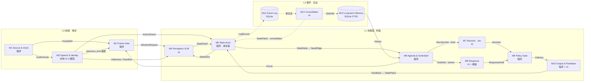
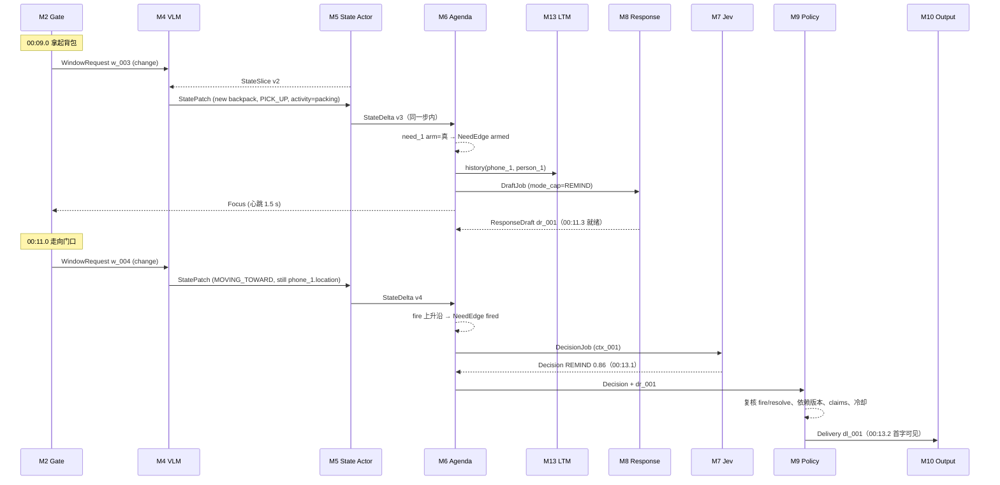

# Proactive Video Agent — 技术设计方案 V2.0

> 版本：2026-11-07 · 状态：设计稿，待工程验证（不是已测试的实现）· 基于 V1.0 修订
> 范围：**单路视频（固定机位或第一人称移动视角）+ 音频** → 状态条件化感知 → FastState（单写者状态机）→ 需求议程触发 → Jev 决策 → 文本 ASK / REMIND → 反馈闭环。不做机器人动作，不自行训练模型。
> 配套可视化：`proactive_video_3d_v2.html`。13 个模块、消息名、20 秒示例剧情与本文档一一对应（见 §7.3）。
> 文中所有时延数字都是**设计目标或示意值**，不是实测结果。

---

## 0. 一页摘要

FastState 的难点是三个问题：**谁来写状态、按什么规则写、写完之后谁来响应**。V2 的回答：

1. **AI 提议，程序裁决。** 看画面的 VLM 拿到"当前状态切片"，只输出对状态的增量补丁（`StatePatch`）。唯一能修改状态的是一个确定性的单写者程序（State Actor）。热路径上**不另设文本 LLM**，感知与状态提议合并为一次模型调用。
2. **状态 = 实体表 + 信念槽 + 需求议程**，常驻内存。SQLite 只做追加日志与快照，任何时刻的状态都能由日志确定性重放得到。
3. **过时由事件驱动，不靠统一 TTL。** 每个属性有动态类别（static / inertial / transient）。物品位置不会因为时间流逝而失效，只会因为"看不见时有人接触过它所在区域"或"区域清楚可见但它不在"而失效。
4. **决策只在触发沿调用。** 每个需求自带预编译的 `arm / fire / resolve` 条件。状态变化经依赖索引在毫秒内完成判断；进入 `armed` 时预取上下文并预生成草稿，到 `fired` 时只调用一次 Jev。
5. **三个时间尺度。** L0 每帧（程序 + 本地小模型）、L1 秒级热路径（一次 VLM，必要时一次 Jev）、L2 后台慢环（LLM 整理、长期记忆）。慢环永远不阻塞热路径。

### 0.1 相对 V1 的变更

| 方面 | V1 | V2 | 原因 |
|---|---|---|---|
| 感知 | ReflectWorld 分段描述，必要时再做一次结构化 VLM 抽取 | **一次**状态条件化 VLM 调用，直接输出 `StatePatch` | 少一跳；ID 绑定交给能看到画面的模型；描述不再是中间瓶颈 |
| 状态写入 | Reducer 消费通用 `ObservationEvent` | Reducer 消费"针对当前状态的补丁"，先经校验与完整性检查 | 补丁天然是差异，便于校验与审计 |
| 过时规则 | 以时效（fresh/stale）为主 | 按属性动态类别；由"交互机会"和"区域可见性"驱动 | 物体不会自己移动；第一人称视角下"没看到"多半只是镜头转开了 |
| 需求 | Commitment 状态机 + 业务规则提出候选 | `Need` 自带条件 DSL、依赖反向索引、边沿检测 | 决策只在必要时调用 |
| 决策调用 | 受影响的 Need 均可能入队 | 仅在 `fired` 沿调用；`armed` 时预取 | 降低成本与时延 |
| 响应 | 决策之后才生成 | `armed` 时预生成草稿，模板兜底 | 降低首字时延 |
| 并发 | 每路至多 1 个感知请求在途 | 2–3 个并行，按序号顺序提交 | 提高吞吐，避免积压 |
| 音频 | 不接入 | ASR + 说话人 + 人脸锚点（M3） | M3-Bench 的问题大量依赖对话 |
| 视角 | 固定机位 | 固定机位 + 第一人称（区域可见性） | M3-Bench-robot 是机器人第一人称视频 |
| 长期记忆 | Graphiti + Neo4j | SQLite FTS5 情节库；M3-Agent 记忆图作为对照；Graphiti 移出核心 | 降低复杂度；V1 自己也把 Graphiti 列为待验证假设 |
| 热存储 | SQLite 多表，每个事件一个事务 | 内存单写者 + 批量追加日志 + 快照 | 更简单、更快，可重放 |
| 视频接入 | ReflectWorld | 自有 Source（PyAV/ffmpeg）；ReflectWorld 降为可选适配器 | 需要自己控制窗口、时钟和提示词 |
| 评测 | ProactiveVideoQA | M3-Bench 状态探针 + 自标介入窗口 + 自拍固定机位小集 | 按用户指定的数据源 |

### 0.2 继承自 V1、不变的原则

- **因果性**：决策只能使用 `t_avail ≤ 决策时刻` 的信息；回放必须按时钟推进，不得把整段视频预先交给模型。
- 不把模型猜测写成事实；允许系统说"不知道"；不使用没有校准依据的伪概率。
- 历史观察（`last_seen`）与当前信念（`value / status`）分开存放。
- "提醒已发送"不等于"问题已解决"。
- 任何模型都不能绕过 State Actor 直接改状态。

---

## 1. 系统总览

### 1.1 三层时间尺度

| 层 | 节奏 | 模块 | 调用 AI？ | 失败的影响 |
|---|---|---|---|---|
| **L0 前端** | 每帧（抽样 5 FPS） | M1 Source、M2 Frame Gate、M3 Speech & Identity | M3 调本地小模型；M1/M2 为纯程序 | 失去输入，必须告警 |
| **L1 热路径** | 秒级 | M4 Perception VLM、M5 State Actor、M6 Agenda、M7 Decision、M8 Response、M9 Policy Gate、M10 Output | 每个窗口 1 次 VLM；仅在 `fired` 时调 1 次 Jev；`armed` 时调 1 次 Response | 提醒变慢或缺失 |
| **L2 慢环** | 10 秒到分钟级，后台运行 | M11 Event Log、M12 Consolidator、M13 Long-term Memory | M12 调较强的 LLM | 只损失历史与语音需求编译，热路径照常运行 |

### 1.2 模块拓扑与消息



### 1.3 每个模块是"调用 AI"还是"程序"

| 模块 | 类型 | 具体实现 / 调用 | 调用频率 | 每次时延（目标） |
|---|---|---|---|---|
| M1 Source & Clock | 程序 | PyAV / ffmpeg 解码；RTSP；虚拟时钟 | 连续 | < 50 ms |
| M2 Frame Gate | 程序 | numpy 帧差（可选轻量图像向量） | 每个抽样帧 | < 20 ms |
| M3 Speech & Identity | 本地 AI 小模型 + 程序 | VAD、ASR（Whisper / FunASR）、声纹嵌入（ERes2NetV2）、人脸（InsightFace RetinaFace+ArcFace）；锚点匹配用程序 | 每句话、每个窗口的帧 | 语句结束后 0.3–1 s |
| M4 Perception VLM | **AI（远程或自部署）** | 快速 VLM，JSON Schema 约束输出 | 每个窗口 1 次，约 15–25 次/分钟 | 1–2.5 s |
| M5 State Actor | 程序 | 纯 Python：Sequencer、Validator、Reducer、Timers | 每个补丁 | < 10 ms |
| M6 Agenda & Scheduler | 程序 | 条件 DSL、依赖索引、边沿检测、调度、预取 | 每个 Delta | < 5 ms（预取异步进行） |
| M7 Decision | **AI（远程）** | TypeSafe System One · Jev（`noul` + `choice`） | **仅在 `fired` 沿** | ≤ 1 s |
| M8 Response | **AI（远程）** + 模板 | GPT-5 mini 流式输出；模板兜底 | 每次 `armed` 1 次，偶尔现场生成 | 0.5–1.5 s（预生成时关键路径为 0） |
| M9 Policy Gate | 程序 | 规则复核 | 每次发送前 | < 5 ms |
| M10 Output & Feedback | 程序 + UI | FastAPI WebSocket，按钮反馈 | 按需 | — |
| M11 Event Log | 程序 / 存储 | SQLite WAL，独立写入任务 | 批量写入（200 ms / 100 条） | 不在关键路径 |
| M12 Consolidator | **AI（远程）** | 较强的通用 LLM（如 GPT-5 或 Claude Sonnet 5.5） | 每 30 s 会话时间一次，另有语音承诺时触发 | 3–15 s，不阻塞 |
| M13 Long-term Memory | 程序 / 存储 | SQLite FTS5（可选向量索引）；可加载 M3-Agent 记忆图 | `armed` 时查询 | < 20 ms |

---

## 2. 公共约定

### 2.1 时间体系

所有消息都放在同一条**会话时间轴**上（毫秒，从会话开始计时）。回放时，会话时间轴与视频 PTS 对齐。

| 字段 | 含义 |
|---|---|
| `t_event_ms` | 内容对应的视频时间；内容是一个区间时取区间终点 |
| `t_avail_ms` | 这条消息在会话时间轴上**变得可用**的时刻 |
| `wall_utc` | 墙钟时间，只用于运维和追踪 |

**因果约束**：任何模块在会话时刻 `now` 只能读取 `t_avail_ms ≤ now` 的消息。评测与日志都依据 `t_avail_ms`。

### 2.2 运行模式

| 模式 | 用途 | 时钟 |
|---|---|---|
| `live` | 真实摄像头 / RTSP | 墙钟 |
| `replay_1x` | 最终的时延验收、演示 | 视频按 1× 推帧，模型真实调用 |
| `replay_sim` | 开发和大规模评测（M3-Bench 单段视频 30–40 分钟） | 离散事件模拟：模型调用真实执行或命中缓存，但 `t_avail = max(t_request, worker_free_at) + 实测时延`，工作池排队同样被模拟 |

`replay_sim` 能保证"看得见什么"与 1× 一致，代价是对排队效应的近似。最终时延数字只采用 `replay_1x` 的结果。

### 2.3 ID 规则

| 对象 | 格式 | 例子 | 说明 |
|---|---|---|---|
| 会话 | `s_<yyyymmdd>_<n>` | `s_20261107_01` | |
| 帧 | `f_<6位序号>` | `f_000061` | 抽样帧的序号 |
| 窗口 | `w_<3位序号>` | `w_004` | 序号 `seq` 单调递增，决定提交顺序 |
| 语句 | `u_<n>` | `u_0007` | |
| 锚点 | `face_<n>` / `voice_<n>` | `face_3` | 由 M3 分配 |
| 实体 | `<cls>_<n>` | `phone_1`、`desk_1` | 由 Reducer 分配；VLM 只能用临时 ID（`n1`） |
| 槽位键 | `<entity>.<attr>` | `phone_1.location` | |
| 需求 | `need_<n>` | `need_1` | |
| 其他消息 | `patch_ / delta_ / edge_ / ctx_ / dec_ / dr_ / dl_ / fb_ / ep_` | | 由各自的生产者分配 |

### 2.4 消息信封

所有跨模块消息都使用同一个信封。`causation_id` 串起完整的因果链：`Delivery ← Decision ← NeedEdge ← StateDelta ← StatePatch ← WindowRequest`，可以用来追踪和计算端到端时延。

```python
class Envelope(BaseModel):
    msg_id: str
    kind: Literal["FrameRef","AudioChunk","Utterance","FaceBox","AnchorEvent","WindowRequest",
                  "StateSlice","StatePatch","StateDelta","NeedEdge","Focus","DraftJob","DecisionJob",
                  "Decision","ResponseDraft","Delivery","Blocked","Feedback","Episode","LogRecord"]
    session_id: str
    t_event_ms: int
    t_avail_ms: int
    causation_id: str | None = None
    payload: dict
```

---

## 3. 模块详细设计

每个模块按同样的结构说明：**职责 · 类型与调用 · 输入 · 输出 · 内部存储 · 关键逻辑 · 失败与降级**。

### M1 Source & Clock（程序）

- **职责**：解码视频和音频，按选定的运行模式推进会话时钟。
- **调用**：PyAV / ffmpeg（文件），OpenCV / ffmpeg（RTSP）。M3-Bench 由专用适配器读取（§10.2）。
- **输入**：MP4 文件或摄像头流；会话配置。
- **输出**：
  - `FrameRef` → M2：从 25–30 FPS 原始流中抽样到 5 FPS，缩放到短边 448 px，图像数组随消息传递；
  - `AudioChunk` → M3：16 kHz 单声道，每块 0.5 s。

```python
class FrameRef(BaseModel):
    frame_id: str            # f_000061
    pts_ms: int              # 视频时间
    t_avail_ms: int
    path: str | None = None  # 只有被选入窗口的帧才落盘
    change_score: float = 0  # 由 M2 回填
class AudioChunk(BaseModel):
    chunk_id: str; start_ms: int; end_ms: int; pcm_ref: str   # 共享内存或临时文件
```

- **内部存储**：无持久化；会话元数据写入 `sessions` 表。
- **失败**：解码出错时跳过坏帧并记录 trace；整路断流超过 3 s 时向 UI 告警（"感知中断"），此时不能把"什么都没看到"当成状态。

### M2 Frame Gate（程序）

- **职责**：维护帧缓冲，判断**什么时候值得调用一次 VLM**，并组装窗口。
- **调用**：纯程序。
- **输入**：`FrameRef`（M1）；`Utterance` 结束事件（M3）；`Focus`（M6）。
- **输出**：`WindowRequest` → M4。

```python
class WindowRequest(BaseModel):
    window_id: str                 # w_004
    seq: int                       # 单调递增，M5 按它的顺序提交
    start_ms: int; end_ms: int
    trigger: Literal["change","utterance","heartbeat","focus"]
    frame_ids: list[str]           # 2–4 帧：变化开始、变化中段、稳定后
    utt_ids: list[str] = []
    focus_entities: list[str] = [] # 来自处于 armed 状态的 Need
```

- **内部存储**：`deque`，保存最近 10 s 的抽样帧（约 50 帧 × 448 px）；入选窗口的帧以 JPEG 落盘到 `media/{session}/frames/`。
- **关键逻辑**：
  - **变化分数**：把帧缩到 64×64 灰度，计算与上一个已提交窗口末帧的平均绝对差；可选用轻量图像向量的余弦距离。阈值 `θ_change` 初始为 0.08，需在数据上标定。
  - **触发规则**（按优先级）：
    1. `focus`：存在处于 armed 的 Need 时，心跳缩短为 1.5 s，窗口带上 `focus_entities`；
    2. `change`：变化分数超过阈值后，等画面稳定 0.3–0.4 s（让动作做完）再发出，最长等 1.5 s；
    3. `utterance`：一句话结束时，发出包含该句和 1–2 帧的窗口；
    4. `heartbeat`：距上一个窗口超过 4 s 时发出。
  - 两个窗口之间至少间隔 0.8 s；窗口覆盖 `[上一窗口末尾, 现在]`。
- **背压**：发往 M4 的队列积压超过 3 个时，合并相邻的 heartbeat 窗口；**change 和 utterance 窗口永不丢弃**。
- **失败**：无。本模块不调用外部服务。

### M3 Speech & Identity（本地 AI 小模型 + 程序）

- **职责**：把音频变成带说话人的语句；把人脸变成稳定的身份锚点，让 VLM 和 Reducer 拿到一致的人物 ID。
- **调用**：
  - VAD → ASR（Whisper 系列或 FunASR）→ 声纹嵌入（3D-Speaker ERes2NetV2，与 M3-Agent 一致）；
  - 人脸：InsightFace `buffalo_l`（RetinaFace + ArcFace，与 M3-Agent 一致），只处理入选窗口的帧；
  - 锚点匹配是程序：计算与已有锚点质心的余弦相似度，超过阈值归入该锚点，否则新建。阈值需按数据集标定。
- **输入**：`AudioChunk`（M1）；入选窗口的帧（M2）。
- **输出**：
  - `Utterance` → M2（作为触发）和 M4（作为窗口内容）；
  - `FaceBox` → M4：在帧上画框并标注 `P1 / P2`（set-of-mark），让 VLM 能把画面中的人对应到状态里的 person；
  - `AnchorEvent` → M5：出现新锚点、锚点归属变化时发出。

```python
class Utterance(BaseModel):
    utt_id: str; start_ms: int; end_ms: int
    text: str
    voice_anchor: str | None      # voice_2
    person_id: str | None         # 已经与 person 实体绑定时填写
    asr_conf: float | None
class FaceBox(BaseModel):
    frame_id: str; bbox: tuple[int,int,int,int]; face_anchor: str; label: str   # "P1"
class AnchorEvent(BaseModel):
    anchor_id: str; kind: Literal["face","voice"]; event: Literal["new","update"]
    person_id: str | None
```

- **内部存储**：`anchors` 表（质心向量以 BLOB 存储、样本数、首次与最近出现时间、绑定的 person）；内存中保留质心矩阵用于快速匹配。
- **关键逻辑**：锚点**在线增量**更新，只用过去的数据，不做整段视频的全局聚类（否则会泄漏未来信息）。人脸与声纹的对应关系不由 M3 判断，而是由 VLM 看到"谁在说话"后用 `link` 补丁提出，Reducer 记录；累计出现 2 次以上才从 `tentative` 转为确认。
- **失败**：ASR 不可用时窗口照常发出，只是没有语音；人脸模型不可用时帧上不画标签，VLM 依靠外观描述绑定人物（准确率会下降，需要在 trace 中标记）。

### M4 Perception VLM（AI，含程序子组件 Slice Builder）

- **职责**：**看画面并提出状态补丁。** 它是热路径上唯一的感知模型调用。
- **调用**：快速 VLM，要求支持多图输入和 JSON Schema 约束输出。候选：GPT-5 mini、Claude Haiku 4.5、Gemini Flash 系列、自部署 Qwen-VL 系列（vLLM）。按 E1 评测（§10.3）的补丁准确率和 P95 时延选定，并锁定具体版本。
- **输入**：`WindowRequest`（M2）、`Utterance` 与 `FaceBox`（M3）、`StateSlice`（M5，在发起调用时读取）。
- **输出**：`StatePatch` → M5（结构见 §4.5）。
- **工作池**：2–3 个 worker 并发。每个窗口发起调用时读取最新状态切片，切片版本号写入补丁。
- **Slice Builder（程序）**：从 State Store 中选出与本窗口相关的实体，最多 20 个实体、10 个地点，约 600–800 token。优先级：
  1. `focus_entities`；
  2. 最近 2 个窗口里可见的实体；
  3. 位于上一窗口可见地点上的物品；
  4. 近期说过话的人。

  如果一个物品所在的地点在上一窗口可见，就把该物品标为 `CHECK`，表示本窗口必须对它给出 `still / gone / unsure` 之一。

```python
class SliceEntity(BaseModel):
    id: str; type: str; cls: str; desc: str
    label: str | None             # 画面上的 P1 / P2
    beliefs: dict[str, str]       # {"location": "ON desk_1 (seen, holds)"}
    check: bool                   # True 时本窗口必须给出 still / gone / unsure
class StateSlice(BaseModel):
    version: int
    entities: list[SliceEntity]
    places: list[str]
    open_needs: list[str]         # 只放 id 和 kind，帮助模型留意相关物品
```

- **提示词结构**（固定前缀放在最前面，便于命中前缀缓存）：

```text
[SYSTEM · 固定前缀，可缓存]
你是视频状态追踪器。根据最近几帧画面和语音，输出对“当前状态”的增量补丁（JSON）。
1. 只能引用 STATE 中已有的实体 ID；新出现的实体用 new，并给临时 ID（n1, n2 …）。
2. 只报告变化。STATE 中标记 CHECK 的条目，必须给出 still / gone / unsure 之一。
3. 看不清就用 unsure。不要猜测身份和所有权。
4. 画面里人物框上的标签 P1、P2 对应 STATE 中带相同标签的 person。
5. 词表：activity ∈ {sitting_working, standing, walking, packing, moving_to_exit, leaving,
   entering, eating, cooking, cleaning, talking, resting, other}；
   location.rel ∈ {ON, INSIDE, NEAR, HELD_BY, WORN_BY, IN_ROOM}；
   act.type ∈ {PICK_UP, PUT_DOWN, PUT_INTO, TAKE_OUT, GIVE, MOVING_TOWARD, ENTER, EXIT,
   OPEN, CLOSE, TURN_ON, TURN_OFF}
6. 语音中出现请求、承诺、偏好或事实陈述时，输出 said，并标注 intent。
[USER]
STATE v3
person_1 [P1] PERSON | 灰色卫衣 | activity=packing (seen, holds)
phone_1 OBJECT phone | 黑色手机 | location=ON desk_1 (seen, holds) | CHECK
backpack_1 OBJECT backpack | 黑色双肩包 | location=HELD_BY person_1 (seen, holds)
PLACES desk_1, door_1
SPEECH [00:10.2–00:11.0] voice_2→person_1: “我得走了”
FRAMES f_000053 (00:10.6)  f_000055 (00:11.0)  f_000056 (00:11.2)
```

- **补丁缓存**：以 `sha1(视频ID, 帧 PTS 列表, 语音文本, 切片文本, prompt_version, model)` 为键，把响应写入 `patch_cache`。上游完全相同时可以直接重放，免去重复调用。
- **失败与降级**：
  - 超时（默认 4 s）或 JSON 不合法：丢弃该补丁，记录 `patch_failed`；被跳过的序号由 Sequencer 放行；下一个窗口的切片仍然带着 `CHECK`，会自然补上。
  - 连续失败 3 次：UI 显示"感知降级"，所有 transient 属性随 TTL 自然转为 `unknown`，**不能**继续沿用旧值。

### M5 State Actor（程序 · 单写者）

- **职责**：**唯一能修改状态的组件。** 依次完成按序提交、校验、归约、计时器处理、生成 Delta，并在同一步里调用 M6 的触发引擎。
- **调用**：纯程序，运行在一个 asyncio 任务里，所有写入都经由它的 inbox。
- **输入**（同一个 inbox）：
  - `StatePatch`，`source ∈ {vlm, user, consolidator}`；
  - `AnchorEvent`（M3）；
  - `Tick`（内部计时器，每 250 ms 会话时间一次）。
- **输出**：
  - `StateDelta` → M6 触发引擎（同步调用）→ `NeedEdge` → M6 Scheduler；
  - `StateSlice` → M4（只读快照，由 M4 发起调用时拉取）；
  - `LogRecord` → M11。
- **内部存储**：`StateStore`（§4.8）放在内存中；每 50 个版本或每 30 s 写一次快照。
- **关键逻辑**（详见 §4）：

```python
async def state_actor(inbox: asyncio.Queue[Envelope]):
    while True:
        env = await inbox.get()
        for patch in sequencer.release(env):          # VLM 补丁按 seq 放行，其他来源直接放行
            ok_ops, rejected = validator.check(patch, store)
            delta = reducer.apply(ok_ops, patch, store)   # 只有真实变化才生成 Delta
            edges = agenda.trigger.on_delta(delta, store) # M6 触发引擎，同步执行，< 5 ms
            log.append(env, patch, rejected, delta, edges)   # 只入队，不等待落盘
            for e in edges: edge_q.put_nowait(e)
            ws.publish(delta, edges)
```

- **Sequencer**：VLM 补丁按 `seq` 提交；先到的后序补丁先缓存。缺失的序号最多等待 5 s，或在收到 `patch_failed` 时立即放行。
- **失败**：本模块不调用外部服务。若 Reducer 抛出异常，该补丁进入隔离区并告警，Actor 继续处理下一个，不崩溃。

### M6 Agenda & Scheduler（程序）

由两部分组成。

- **触发引擎**：在 M5 的同一步内同步执行，保证 `NeedEdge` 与状态版本严格一致。
- **Scheduler / Prefetcher**：独立的 asyncio 任务，消费 `NeedEdge`。

**职责**：
- 管理需求（`Need`）：用模板实例化需求，编译语音中的需求；
- 判断条件、检测边沿；
- 在 `armed` 时预取，在 `fired` 时调度决策。

**调用**：纯程序。它会**触发** M7、M8、M13，但自己不调用模型。

**输入与输出**：
- 输入：`StateDelta`；来自 M12 的 `need_upsert` 补丁（经 M5 转来）。
- 输出：
  - `NeedEdge`；
  - `Focus` → M2；
  - `DraftJob` → M8；
  - `DecisionJob` → M7；
  - 汇合 `Decision` 与 `ResponseDraft` 后交给 M9。

**内部存储**：`AgendaStore`（§5.6），放在内存中。

**关键逻辑**（详见 §5）：
- `Delta.changes` 中的槽位键经 `dep_index` 反查到受影响的 Need，只重新计算这些 Need 的 `arm / fire / resolve`，并与上次结果比较得到边沿。
- **armed**：
  - 立即组装 `DecisionContext` 草稿；
  - 查询 M13 历史（k=3）；
  - 按 `mode_cap` 让 M8 预生成草稿；
  - 向 M2 发出 `Focus`（心跳缩短为 1.5 s，并关注相关实体）。
- **fired**：
  - 刷新上下文中的依赖槽位（毫秒级）；
  - 投递 `DecisionJob`。每个 Need 至多 1 个在途，全局至多 2 个；
  - 新的 fired 会覆盖尚未开始的旧 job。
- **WAIT**：Need 回到 `armed`，至少 5 s 后才允许再次决策。
- **disarmed**（arm 条件持续为假 3 s）：取消预取和草稿，撤销 Focus。

### M7 Decision · Jev（AI）

- **职责**：在需求触发的那一刻，判断是否值得介入，以及用哪种方式介入。
- **调用**：TypeSafe System One。一次调用包含两个问题：
  - `warranted`（`noul`）：当前是否值得介入；
  - `mode`（`choice`：`WAIT / ASK / REMIND`）。

  开发时使用 `jev-latest`，实验时锁定具体版本，并记录返回的实际版本。接口细节沿用 V1，本版未重新核实。
- **输入**：`DecisionJob{context: DecisionContext}`（§6.1）。
- **输出**：`Decision` → M9。
- **程序规则**（在 M6 Scheduler 中执行，不交给模型）：
  - `warranted < 0.7` 时视为 WAIT。0.7 是待校准的初始值。
  - 若 `mode` 高于 Need 的 `mode_cap`（例如目标物品的信念不是 `seen/holds`），**只降级、不升级**：REMIND 改为 ASK。
- **失败**：超时（默认 2 s）或输出不合法时，记为 `DECISION_UNAVAILABLE`，不伪装成 WAIT。按配置 `on_unavailable` 处理：
  - `wait`（默认）：只记录；
  - `rule_ask`：当 `mode_cap` 允许时，用模板发出一个 ASK。

### M8 Response（AI + 模板）

- **职责**：生成要发给用户的那句话，并声明这句话断言了哪些状态（`claims`）。
- **调用**：GPT-5 mini，结构化输出。现场生成时用流式输出。每种需求都配有模板作为兜底。
- **输入**：`DraftJob{need, context, mode}`。
- **输出**：`ResponseDraft` → 由 M6 汇合后交给 M9（§6.3）。
- **策略**（配置项 `response.strategy`）：
  - `prefetch_llm`（默认）：`armed` 时按 `mode_cap` 预生成。`fired` 后若 Jev 给出的 mode 与草稿一致，且依赖槽位版本未变，就直接使用草稿；否则现场生成，若超过 600 ms 未出首字则改用模板。
  - `template_first`：始终使用模板，时延最低。
  - `llm_first`：总是在决策之后现场生成。这是 V1 的做法，作为消融对照。
- **失败**：任何失败都退回模板，不阻塞发送。

### M9 Policy Gate（程序）

- **职责**：发送前做最后一次复核，防止发出过期或越权的消息。
- **调用**：纯程序。
- **检查项**（任何一项不通过就输出 `Blocked(reason)`，否则输出 `Delivery`）：
  1. Need 仍处于 `deciding`，没有变成 `resolved / dismissed`；
  2. 用**当前**状态重新计算：`fire` 仍为真，`resolve` 仍为假；
  3. 依赖槽位的版本相对上下文快照有变化时，重新计算 `mode_cap`；若需要降级且草稿与之不符，改用 ASK 模板；
  4. `claims` 与当前信念一致：只有在 `status=holds`、`source ∈ {seen, user_confirmed}` 且距上次支持不超过 10 s 时，才允许 `stated_as=certain`；
  5. 权限、免打扰时段、全局限频（≤ 1 条 / 30 s）、每个需求的冷却时间与最大提醒次数、去重。

### M10 Output & Feedback（程序 + UI）

- **职责**：把消息展示给用户，收集反馈，并把反馈转换成状态补丁。
- **调用**：FastAPI + WebSocket；前端为现有页面（后续可把 3D 可视化接入实时模式）。
- **输出**：
  - `Delivery` 显示时记录 `t_first_visible_ms`；
  - 用户点击按钮后生成 `Feedback`，再转换为 `StatePatch(source="user")` 送入 M5：
    - `done`（已拿到）：对相关槽位发出 `confirm`，Need 转为 `resolved`；
    - `not_needed`（不需要）：Need 转为 `dismissed`，并写入偏好：同一个人和物品 2 小时内不再提醒；
    - `wrong`（不是我的 / 判断错误）：Need 转为 `dismissed`，并标记为误报，供评测使用。

### M11 Event Log（存储 · 程序）

- **职责**：所有消息的唯一持久化位置，用于崩溃恢复、确定性重放和评测。
- **实现**：SQLite WAL。由独立的 writer 任务从 `ch.log` 批量写入，每 200 ms 或每 100 条提交一次。表结构见 §8.2。
- **恢复**：加载最新快照，再重放 `log_seq > snapshot.log_seq` 的所有 `StatePatch / AnchorEvent / Tick`，得到与崩溃前完全相同的状态。
- **重放实验**：保持 VLM 补丁不变（取自日志或 `patch_cache`），只替换 Reducer 规则或 Agenda 模板，就能在不重新调用 VLM 的情况下比较下游决策。

### M12 Consolidator（AI · 后台）

- **职责**：做不需要实时完成、但需要较强推理能力的事情。
- **调用**：较强的通用 LLM（如 GPT-5 或 Claude Sonnet 5.5），结构化输出。
- **触发**：
  - 每 30 s 会话时间一次；
  - 出现 `said(intent ∈ {request, commitment})` 时立即触发。
- **任务**：
  1. **编译语音需求**：把"出门时提醒我带伞"编译成 §5.2 的条件 DSL（优先套用模板），输出 `need_upsert` 补丁，由 M5/M6 校验路径和词表后生效；
  2. **实体合并建议**：对 `maybe_same` 中的候选给出合并建议及理由。默认只记录、不自动合并；只有满足程序规则（同一地点、从未同时出现在画面中、外观描述一致）时才输出 `merge`；
  3. **情节摘要**：把近 30 s 的 Delta 和语句总结成 `Episode`，写入 M13。
- **输出**：`StatePatch(source="consolidator")` → M5；`Episode` → M13。
- **失败**：只记录日志，热路径不受影响。

### M13 Long-term Memory（存储 · 程序）

- **职责**：回答"以前发生过什么"，为决策上下文提供少量历史。
- **实现**：SQLite FTS5 情节库（`episodes` 表），可选向量索引。在 M3-Bench 上可以加载 M3-Agent 公开的记忆图（`.pkl`），作为对照检索源。
- **接口**：`history(entity_ids, kind, before_ms=now, k=3)`，只返回 `t_avail_ms ≤ now` 的情节（双时间约束，沿用 V1 的防泄漏要求）。
- **与 V1 的关系**：Graphiti / Neo4j 不进入 V2 核心。只有当长期历史题上的消融显示有稳定增益时，才作为 M13 的替代实现接入。

```python
class Episode(BaseModel):
    episode_id: str; session_id: str
    t_start_ms: int; t_end_ms: int; t_avail_ms: int
    entity_ids: list[str]
    text: str                     # "person_1 在 desk_1 前工作；00:02 把 phone_1 放在 desk_1 上"
    source_log_seqs: list[int]
```

---

## 4. FastState 状态模型（M5 内部）

### 4.1 三层结构

```text
StateStore
├── entities      dict[entity_id, Entity]          谁 / 什么
├── beliefs       dict["entity.attr", Belief]      当前信念（每个槽位一个值）
├── 派生索引       by_place、place_last_visible、timers
AgendaStore（M6）
└── needs、dep_index、attr_index、last_eval、prefs
```

逻辑上它是一张小图：实体是节点，位置关系是带引用的属性值。但实现上用"实体表 + 函数式槽位"，原因有三：

- 一个槽位只有一个值，变化检测就是比较新旧值；
- 冲突就是同一个槽位来了两个不同的值；
- 依赖索引可以直接用槽位键。

V2 不需要图数据库。

### 4.2 实体

```python
class Entity(BaseModel):
    id: str                        # person_1 / phone_1 / desk_1 / door_1
    type: Literal["PERSON","OBJECT","PLACE","DEVICE"]
    cls: str                       # phone / desk / door / backpack
    desc: str                      # 简短外观描述，供 VLM 绑定 ID
    anchors: dict[str, str] = {}   # {"face": "face_3", "voice": "voice_2"}
    label: str | None = None       # 画面标签 P1（仅 PERSON）
    identity: Literal["confirmed","tentative"] = "tentative"
    maybe_same: list[str] = []     # 合并候选，由慢环裁决
    room: str | None = None        # 第一人称视角下所属房间（PLACE 实体）
    first_seen_ms: int; last_visible_ms: int
```

- VLM 输出的 "phone" 只是一次提及，不是身份。出现两个相似物品时，保留两个实体。
- 只有满足以下条件之一，实体才从 `tentative` 转为 `confirmed`：PERSON 有稳定的人脸锚点，或被重复观察到 ≥ 3 次且没有冲突。

### 4.3 属性注册表（`state/attrs.yaml`）

| 属性 | 适用类型 | 值类型 | 动态类别 | 失效规则 |
|---|---|---|---|---|
| `location` | OBJECT, DEVICE | `Loc{rel, ref}`，rel ∈ ON / INSIDE / NEAR / HELD_BY / WORN_BY / IN_ROOM | **inertial** | 见 §4.6，不按时间失效 |
| `state` | DEVICE、PLACE（门） | on / off / open / closed | **inertial** | 同上 |
| `activity` | PERSON | 受控词表（§3 M4 提示词） | **transient**，TTL 8 s | 8 s 内没有新的支持 → `unknown` |
| `presence` | PERSON | in_view / out_of_view / left | transient，`in_view` TTL 3 s | 超时转为 `out_of_view`，而不是 `unknown` |
| `near` | PERSON | 地点引用 | transient，TTL 5 s | 超时 → `unknown` |
| `room` | PERSON, OBJECT | 房间引用 | inertial | 仅第一人称模式使用 |
| `owner` | OBJECT | person 引用 | **static** | 只能由用户确认或语音（heard）写入，不由视觉推断 |

**派生属性（不存储，查询时计算）**：

- `holding(p)` = 所有 `location = HELD_BY p` 的物品；
- `with(x, p)`：沿 `x.location` 的 INSIDE / ON 链向上最多 3 层，若到达 `HELD_BY p` 或 `WORN_BY p` 则为真。例如手机放进了背包，而背包在人手上，`with(phone, person)` 为真。

"手里拿着什么"只由物品的 `location` 推出，不单独存储，避免两处不一致。

### 4.4 Belief：信念槽

```python
class Belief(BaseModel):
    key: str                        # "phone_1.location"
    value: Any | None               # {"rel": "ON", "ref": "desk_1"}；不知道时为 None
    source: Literal["seen","heard","inferred","user_confirmed","consolidator"]   # 信息从哪来
    status: Literal["holds","stale","unknown","conflicted"]                      # 现在还算不算数
    since_ms: int                   # 这个值从视频哪一刻开始成立
    last_support_ms: int            # 最近一次被证据支持
    last_seen: dict | None          # {"value":…, "t_ms":…, "evidence":[…]}，历史记录，永不清除
    evidence: list[str]             # 支持当前值的帧 ID / 语句 ID / 补丁 ID
    contra: list[str] = []          # 被否决的反向证据，留作审计
    rev: int                        # 槽位版本号；值或状态变化时 +1
    stale_reason: str | None = None # interaction_unobserved | out_of_view_long | ...
```

`source` 和 `status` 是两个独立的维度：

- `source=seen, status=stale`：以前亲眼看到过，但之后有人在看不见的时候靠近过它；
- `source=heard, status=holds`：用户说过钥匙在抽屉里，之后没有反证。

### 4.5 StatePatch：补丁合同

```python
class StatePatch(BaseModel):
    patch_id: str
    source: Literal["vlm","user","consolidator"]
    window_id: str | None = None; seq: int | None = None
    slice_version: int | None = None       # VLM 看到的是哪个版本的切片
    model: str | None = None; prompt_version: str | None = None
    t_event_ms: int
    view: ViewInfo | None = None
    ops: list[Op]
    latency_ms: int | None = None

class ViewInfo(BaseModel):
    room: str | None                       # 第一人称模式下必填
    visible_places: list[str]              # 本窗口清楚可见的地点
    persons_visible: list[str]
    quality: Literal["clear","partial","poor"]
```

| op | 字段 | 谁可以发 | 含义 |
|---|---|---|---|
| `new` | `tmp, type, cls, desc, at?` | vlm | 新实体；`at` 为所在地点（可选） |
| `set` | `key, value, src(seen/heard/inferred), ev[]` | vlm | 槽位取新值 |
| `act` | `type, subj, obj, target?, ev[]` | vlm | 动作，由 Reducer 翻译成槽位变化 |
| `still` | `keys[]` | vlm | 这些槽位仍然成立（只刷新支持时间，不产生 Delta） |
| `gone` | `keys[], ev[]` | vlm | 区域清楚可见，但该槽位已经不成立 |
| `unsure` | `keys[], reason` | vlm | 看不清，不改值 |
| `said` | `utt_id, speaker, intent, content, about[], due?` | vlm | 语音内容；intent ∈ request / commitment / preference / info / none |
| `link` | `person, anchor` | vlm | 把人脸或声纹锚点与 person 关联 |
| `confirm` | `key, value` | user | 用户确认 |
| `need_feedback` | `need_id, kind` | user | done / not_needed / wrong |
| `need_upsert` | `need` | consolidator | 新增或修改需求（需通过 DSL 校验） |
| `merge` | `keep, drop, reason` | consolidator | 合并实体 |

### 4.6 Validator 与 Reducer 规则

**Validator（按顺序执行，不通过的 op 进入隔离区，并记录 `patch_rejected` 及原因）**：

1. 用 Pydantic 校验 schema；整体不合法则丢弃整个补丁。
2. 引用必须存在：`key` 中的实体要么在切片里，要么由本补丁的 `new` 创建；属性必须在注册表中，且适用于该实体类型；取值必须符合类型与词表。
3. op 必须属于该来源允许的集合（见上表）。
4. 证据引用必须来自本窗口的帧或语句。
5. **完整性**：切片中标记为 `CHECK` 的条目，如果在补丁中没有出现，自动补一条 `unsure(reason="omitted")`。漏报不会被当成"仍然成立"，也不会被当成"已经不在"。

**Reducer 规则表**（`t` 为补丁的 `t_event_ms`）：

| 输入 | 状态变化 | 禁止的推断 |
|---|---|---|
| `new` | 分配 ID `{cls}_{n}`，`identity=tentative`；若带有 `at`，同时写入 `location`（seen） | 不按文字相似度合并到已有实体 |
| `set(src=seen)` | 值改变：`value←新值, since=t, rev+1`；无论值是否改变：`status=holds, last_support=t, last_seen←(值, t, 证据)` | — |
| `set(src=heard)` | 若当前 `source ∈ {seen, user_confirmed}` 且 `last_support > 该语句时间`，只记入 `contra`；否则以 `source=heard` 写入 | 不让过时的口述覆盖更新的亲眼所见 |
| `act PICK_UP(p, x)` | `x.location ← HELD_BY p` | 不推断已放进口袋或背包 |
| `act PUT_DOWN(p, x, target)` | `x.location ← ON target` | 不推断 x 属于 p |
| `act PUT_INTO(p, x, c)` | `x.location ← INSIDE c` | — |
| `act TAKE_OUT(p, x, c)` / `GIVE(p, x, q)` | `x.location ← HELD_BY p` / `HELD_BY q` | — |
| `act MOVING_TOWARD(p, place)` | 若 place 是门或出口，`p.activity ← moving_to_exit`；否则 `walking`。同时 `p.near ← place` | 不断言已经离开 |
| `act EXIT(p, door)` | `p.activity ← leaving, p.presence ← left` | — |
| `act OPEN / CLOSE / TURN_ON / TURN_OFF` | `device.state ←` 对应值 | — |
| `still(keys)` | `last_support=t`；若原为 `stale`，恢复为 `holds`（重新看到了） | — |
| `gone(keys)` | `status ← unknown, value ← None`，保留 `last_seen`，并记录负证据 | 不推断物品被谁拿走了 |
| `unsure(keys)` | 不改值；inertial 属性保持原状，transient 属性交给 TTL | 遮挡 ≠ 被拿走 |
| `said` | 写入语句记录；若 `intent ∈ {request, commitment}`，交给 M6 生成 `draft` 状态的 Need，并通知 M12 编译 | 不把语句里的猜测当成观察 |
| `link` | 在实体上记录锚点；同一对 (person, anchor) 出现 ≥ 2 次后确认 | — |
| `confirm`（user） | `source ← user_confirmed, status ← holds` | — |
| `view` | 更新 `place_last_visible`；不在 `persons_visible` 中的人 `presence ← out_of_view`；执行 §4.7 的交互机会规则 | — |
| `Tick(now)` | transient 槽位若 `now - last_support > TTL`，设为 `unknown`，值移入 `last_seen` | — |

### 4.7 过时与失效：惯性属性的两条规则

1. **交互机会**：如果 person `p` 在 `t` 时刻靠近地点 X（`near = X`，或有 `act` 涉及 X），而该窗口中 X 不可见（`X ∉ visible_places` 或 `quality = poor`），那么所有 `location.ref = X` 且 `status = holds` 的物品改为 `stale`（`stale_reason = interaction_unobserved`）。
2. **区域可见但缺失**：X 清楚可见，而切片中位于 X 的物品被 VLM 报告为 `gone`，则改为 `unknown`。如果 VLM 漏报，Validator 只会补 `unsure`，不会据此推断物品不在。

第一人称模式的补充规则：镜头离开某个房间，不会让房间里物品的位置失效；只有人在镜头外进入过该房间，才会触发规则 1（依据 `p.room` 的变化）。

### 4.8 冲突、乱序与 Delta

- **来源优先级**：`user_confirmed(4) > seen(3) > heard(2) > inferred(1) = consolidator(1)`。
- **时间守卫**：如果某个 op 的 `t_event_ms < belief.last_support_ms`，且来源优先级不高于当前来源，就忽略它（记录为 `stale_op`）。
- **conflicted**：同一个补丁里对同一槽位给出互斥的值；或者目标实体是 `tentative` 且 `maybe_same` 非空，而新观察无法区分是哪一个。冲突时两条证据都保留，并在 DecisionContext 中如实呈现。
- **Delta**：只有当值或状态发生变化时才生成。`still` 只刷新时间，不生成 Delta，因此不会触发任何后续计算。

```python
class SlotChange(BaseModel):
    key: str
    old: Any | None; new: Any | None
    old_status: str | None; new_status: str
    source: str; reason: str          # "act:PICK_UP" / "tick:ttl" / "rule:interaction_unobserved"
    rev: int
class StateDelta(BaseModel):
    delta_id: str
    version_from: int; version_to: int
    t_event_ms: int; t_avail_ms: int
    caused_by: str                    # patch_id 或 tick_id
    changes: list[SlotChange]
```

### 4.9 内存结构与快照

```python
class StateStore:
    version: int
    entities: dict[str, Entity]
    beliefs: dict[str, Belief]             # "phone_1.location" → Belief
    by_place: dict[str, set[str]]          # "desk_1" → {"phone_1"}；随 location 维护
    place_last_visible: dict[str, int]
    timers: list[tuple[int, str]]          # heapq，(过期时刻, 槽位键)
    utterances: deque[Utterance]           # 最近 5 分钟
    def slice_for(self, req: WindowRequest) -> StateSlice: ...
    def snapshot(self, keys: list[str] | None = None) -> dict: ...   # 深拷贝，供只读方使用
```

- 规模通常是几十到几百个实体，内存与 CPU 开销都可以忽略。
- 只读方（Slice Builder、Context Builder、Policy Gate）一律读取快照，并记录 `version` 和各槽位的 `rev`。
- 每 50 个版本或每 30 s，把快照写入 `snapshots` 表。

---

## 5. 需求议程与触发（M6 内部）

### 5.1 Need

```python
class Need(BaseModel):
    need_id: str
    kind: str                               # possible_forgotten_item / appliance_left_on / user_request …
    origin: Literal["template","speech","consolidator"]
    bindings: dict[str, str]                # {"item": "phone_1", "person": "person_1"}
    arm: Cond; fire: Cond; resolve: Cond; dismiss: Cond | None = None
    mode_rule: list[ModeRule]               # 根据状态给出 mode 的上限（mode_cap）
    deps: list[str]                         # 由条件静态分析得到的槽位键
    phase: Literal["draft","idle","armed","fired","deciding","awaiting_feedback",
                   "resolved","dismissed","expired"]
    phase_since_ms: int
    cooldown_until_ms: int = 0
    reminders_sent: int = 0; max_reminders: int = 2
    prefetch: PrefetchBundle | None = None  # armed 时填充
    edges: list[str] = []                   # NeedEdge 历史
```

### 5.2 条件 DSL（JSON，便于 LLM 生成和程序校验）

```text
Cond := {"all": [Cond…]} | {"any": [Cond…]} | {"not": Cond}
      | {"path": Path, "<cmp>": Value}            cmp ∈ eq, ne, in, nin, gt, lt, exists
      | {"fn": Fn, "args": [...]}                 Fn ∈ with, present, visible, age_gt
Path := "<$变量|实体ID>.<属性>[.<字段>][#元信息]"
        字段：Loc 的 rel / ref
        元信息：status | source | age_ms | rev
```

- 槽位缺失或 `value=None` 时，除 `exists` 外的所有比较都返回 false。
- `with()` 在位置未知时返回 false。
- 静态分析：把所有 `path` 收集进 `deps`；`with()` 依赖所有 `*.location`，登记在 `attr_index["location"]` 中。

### 5.3 需求模板（`agenda/templates.yaml`，示例）

```yaml
- kind: possible_forgotten_item
  params:
    item:   {type: OBJECT, cls_in: [phone, keys, wallet, glasses, badge, umbrella, laptop]}
    person: {type: PERSON}
  instantiate:                       # 每个 item×person 组合至多一个活跃 Need
    all:
      - {path: "$item.location.rel", in: [ON, INSIDE]}
      - {fn: present, args: ["$person"]}
  arm:
    all:
      - {path: "$person.activity", in: [packing, standing]}
      - {not: {fn: with, args: ["$item", "$person"]}}
  fire:
    all:
      - {path: "$person.activity", in: [moving_to_exit, leaving]}
      - {not: {fn: with, args: ["$item", "$person"]}}
      - {path: "$item.location#status", in: [holds, stale]}
  resolve:
    any:
      - {fn: with, args: ["$item", "$person"]}
  dismiss:
    any:
      - {path: "$person.activity", eq: sitting_working}
  mode_rule:                          # mode 的上限；最终由 Jev 选择，程序只降级
    - when: {all: [{path: "$item.location#status", eq: holds},
                   {path: "$item.location#source", in: [seen, user_confirmed]}]}
      cap: REMIND
    - when: {}
      cap: ASK
  cooldown_s: 120
  max_reminders: 2
```

V2 首批模板：

| kind | 场景 | 来源 |
|---|---|---|
| `possible_forgotten_item` | 人要离开，重要物品不在身上 | 模板 |
| `appliance_left_on` | 炉灶或熨斗处于 on，人离开 | 模板 |
| `told_vs_seen_conflict` | 口述位置与看到的位置矛盾 | 模板，只允许 ASK |
| `user_request` | "出门时提醒我带伞""8 点提醒我吃药" | 语音 → M12 编译 |

### 5.4 Need 状态机

```text
draft ──(M12 编译并通过校验)──▶ idle
idle ──(arm 变真)──▶ armed ──(arm 持续为假 3 s)──▶ idle
idle/armed ──(fire 上升沿，且不在冷却期)──▶ fired ──(Scheduler 投递)──▶ deciding
deciding ──(WAIT / 被拦截)──▶ armed（≥ 5 s 后才能再次决策）
deciding ──(Delivery)──▶ awaiting_feedback
awaiting_feedback ──(resolve 变真 或 用户 done)──▶ resolved
awaiting_feedback ──(用户 not_needed / wrong)──▶ dismissed
awaiting_feedback ──(60 s 无反馈，fire 仍为真，reminders_sent < max)──▶ armed（允许升级）
任意状态 ──(resolve 变真)──▶ resolved；绑定的实体被合并或删除 ──▶ expired
```

### 5.5 NeedEdge 与预取包

```python
class NeedEdge(BaseModel):
    edge_id: str; need_id: str
    edge: Literal["instantiated","armed","disarmed","fired","resolved","dismissed","expired"]
    state_version: int; t_ms: int
    caused_by: str                          # delta_id
    dep_revs: dict[str, int]                # 发生边沿时各依赖槽位的 rev
class PrefetchBundle(BaseModel):
    context: DecisionContext                # armed 时组装，fired 时只刷新依赖槽位
    history: list[dict]                     # M13 结果（≤ 3 条）
    draft: ResponseDraft | None             # M8 预生成
    created_ms: int
```

### 5.6 AgendaStore（内存）

```python
class AgendaStore:
    needs: dict[str, Need]
    dep_index: dict[str, set[str]]          # "phone_1.location" → {"need_1"}
    attr_index: dict[str, set[str]]         # "location" → 使用 with() 的 Need
    last_eval: dict[str, tuple[bool, bool, bool]]   # (arm, fire, resolve) 的上次结果
    prefs: list[Preference]                 # 用户偏好（例如对某物品 2 小时内不再提醒）
    templates: list[NeedTemplate]
```

---

## 6. 决策与响应合同

### 6.1 DecisionContext（M6 组装，M7 和 M8 共用同一份快照）

```json
{
  "context_id": "ctx_001", "session_id": "s_20261107_01",
  "need_id": "need_1", "state_version": 4, "t_ms": 12300,
  "role": "个人助理：尽量少打扰，只在可能造成实际损失时提醒",
  "permissions": {"may_ask": true, "may_remind": true},
  "need": {
    "kind": "possible_forgotten_item",
    "bindings": {"item": "phone_1 (黑色手机)", "person": "person_1 (P1)"},
    "fire_reason": "person_1.activity: packing → moving_to_exit",
    "reminders_sent": 0, "mode_cap": "REMIND"
  },
  "beliefs": [
    {"key": "phone_1.location", "value": "ON desk_1", "source": "seen", "status": "holds", "age_s": 0.0, "last_seen": "ON desk_1 @00:02"},
    {"key": "person_1.activity", "value": "moving_to_exit", "source": "seen", "status": "holds", "age_s": 0.0},
    {"key": "backpack_1.location", "value": "HELD_BY person_1", "source": "seen", "status": "holds", "age_s": 1.9}
  ],
  "recent_changes": ["00:09 backpack_1 → HELD_BY person_1", "00:11 person_1 → moving_to_exit"],
  "history": [{"text": "person_1 在 desk_1 前工作；00:02 把 phone_1 放在 desk_1 上", "ref": "ep_001"}],
  "dep_revs": {"phone_1.location": 1, "person_1.activity": 3}
}
```

- token 预算为 1200–2000，只放与当前 Need 相关的内容。
- 不放完整日志，也不放全部画面描述。

### 6.2 Decision

```json
{"decision_id": "dec_001", "context_id": "ctx_001", "need_id": "need_1",
 "model": "jev-<pinned-version>", "status": "ok",
 "warranted": 0.86, "mode": "REMIND", "mode_probs": {"WAIT": 0.08, "ASK": 0.21, "REMIND": 0.71},
 "applied_mode": "REMIND", "latency_ms": 780}
```

- `status ∈ {ok, unavailable, invalid}`。
- `applied_mode` 是经过阈值和 `mode_cap` 降级规则处理后的结果。
- `warranted` 和 `mode_probs` 是模型给出的决策输出，不是"手机在桌上"的概率，也不是"用户忘了"的证据。

### 6.3 ResponseDraft 与 Delivery

```json
{"draft_id": "dr_001", "need_id": "need_1", "mode": "REMIND",
 "text": "你的手机好像还在桌上，要带上吗？",
 "claims": [{"key": "phone_1.location", "value": "ON desk_1", "stated_as": "probable"}],
 "evidence": ["f_000012", "f_000046"], "context_version": 3, "model": "gpt-5-mini",
 "created_t_ms": 11300, "latency_ms": 900, "origin": "prefetch"}
```

```json
{"delivery_id": "dl_001", "need_id": "need_1", "decision_id": "dec_001", "draft_id": "dr_001",
 "text": "你的手机好像还在桌上，要带上吗？", "channel": "ui_text",
 "t_first_visible_ms": 13200, "feedback_options": ["已拿到", "不需要", "不是我的"]}
```

模板示例（`response/templates.py`）：

- REMIND：`"{item}还在{place}上，记得带上。"`
- ASK：`"{item}是不是还在{place}？"`

---

## 7. 模块间数据交互

### 7.1 通道一览（单进程 asyncio）

| 通道 | 生产者 → 消费者 | 消息 | 实现 | 容量与背压 |
|---|---|---|---|---|
| `ch.frames` | M1 → M2 | FrameRef + 图像数组 | `asyncio.Queue(64)` | 满了丢弃最旧的帧（缓冲只需要最近 10 s） |
| `ch.audio` | M1 → M3 | AudioChunk | `Queue` | 不丢 |
| `ch.utt` | M3 → M2、M4 | Utterance | 广播 | 不丢 |
| `ch.windows` | M2 → M4 | WindowRequest | `PriorityQueue`，优先级 focus > change > utterance > heartbeat | 积压超过 3 时合并 heartbeat；change 和 utterance 不丢 |
| `ch.state_in` | M4、M3、M10、M12、Tick → M5 | StatePatch / AnchorEvent / Tick | 单一 inbox `Queue` | 不丢；VLM 补丁经 Sequencer 按序提交 |
| `ch.edges` | M5（触发引擎）→ M6 Scheduler | NeedEdge | `Queue` | 不丢 |
| `ch.focus` | M6 → M2 | Focus | 直接调用 | 后到的覆盖先到的 |
| `ch.draft` | M6 → M8 | DraftJob | `Queue`，全局 ≤ 2 在途 | disarmed 时取消 |
| `ch.decide` | M6 → M7 | DecisionJob | `Queue`，每个 Need ≤ 1、全局 ≤ 2 在途 | 新的 fired 覆盖尚未开始的 job |
| `ch.gate` | M6（汇合 Decision 与 Draft）→ M9 | GateRequest | 函数调用 | — |
| `ch.out` | M9 → M10 | Delivery / Blocked | WebSocket | — |
| `ch.log` | 所有模块 → M11 | LogRecord | `Queue` → 批量写入 | 不丢；磁盘慢时扩大内存缓冲并告警 |
| `ch.ws` | 所有模块 → UI | 运行时事件 | WebSocket 广播 | 可丢（只用于展示） |

### 7.2 时序图（示例剧情的关键段落）



### 7.3 示例剧情逐步拆解（与可视化 HTML 一一对应）

固定机位，20 s。时间均为示意值。

| 会话时间 | 发生了什么 | 模块与消息 | 状态 / 议程 |
|---|---|---|---|
| 00:00.0 | 会话开始 | M1→M2 `FrameRef`，M1→M3 `AudioChunk` | 空 |
| 00:00.4 → 01.5 | W0（heartbeat） | M2→M4 `WindowRequest w_000`；M5→M4 `StateSlice v0`（空）；M4→M5 `StatePatch`：`new` person / desk / door，`set activity=sitting_working` | v1：`person_1.activity = sitting_working (seen, holds)` |
| 00:02.0 | 手机放到桌上 | — | — |
| 00:02.4 → 03.6 | W1（change） | `StatePatch`：`new phone_1`，`set location = ON desk_1` → `StateDelta v2` → 触发引擎按模板实例化 Need | v2；`need_1` 进入 idle |
| 00:06.0 | W2（heartbeat） | `StatePatch`：只有 `still` → **不生成 Delta、不评估、不调用决策** | 不变 |
| 00:07.5 | 慢环 | M11→M12→M13 `Episode ep_001` | 不变（热路径不受影响） |
| 00:09.0 | 拿起背包 | — | — |
| 00:09.3 → 10.4 | W3（change） | `StatePatch`：`new backpack_1`，`act PICK_UP(person_1, backpack_1)`，`set activity=packing` → `StateDelta v3` → `NeedEdge armed` | v3；`need_1` armed；预取上下文与历史；`DraftJob`；`Focus`（心跳 1.5 s） |
| 00:10.2 → 11.0 | 边说“我得走了”边走向门口 | M3 `Utterance u_0001`（语句结束触发窗口） | — |
| 00:11.3 | 草稿就绪 | M8→M6 `ResponseDraft dr_001` | 草稿缓存于 `need_1.prefetch` |
| 00:11.3 → 12.3 | W4（change + utterance） | `StatePatch`：`act MOVING_TOWARD(person_1, door_1)`，`still phone_1.location`，`said(u_0001 “我得走了”, intent=info)` → `StateDelta v4` → `NeedEdge fired` → `DecisionJob` | v4；`need_1` 进入 fired，随后转为 deciding |
| 00:12.3 → 13.1 | Jev | `Decision`：warranted 0.86，REMIND（未超过 mode_cap） | deciding |
| 00:13.2 | 发送 | M9 复核通过 → `Delivery dl_001`（直接使用预生成的草稿） | awaiting_feedback；从开始走向门口到首字可见约 2.2 s |
| 00:13.8 | W5（focus heartbeat） | `still` | 不变 |
| 00:15.0 → 16.0 | 取回手机，W6 | `StatePatch`：`act PICK_UP(person_1, phone_1)` → `phone_1.location = HELD_BY person_1` → `StateDelta v5` → resolve 变真 | v5；`need_1` resolved |
| 00:17.2 | 用户点击"已拿到" | M10 `Feedback` → `StatePatch(source=user, confirm)` | v6；`phone_1.location` 的来源变为 `user_confirmed` |
| 00:18.5 | 恢复静默 | 只有 heartbeat；所有消息都已进入 M11 | 无活跃需求 |

对照 V1 的可视化：V1 在 00:06 轮询了一次决策，00:15 才发出提醒。V2 在 00:13.2 发出，并且在 00:12.3 之前没有调用过任何一次决策模型。

---

## 8. 存储布局

### 8.1 总览

| 数据 | 位置 | 生命周期 |
|---|---|---|
| 实体、信念、索引 | M5 内存 | 会话期间；快照落盘 |
| 需求、依赖索引、偏好 | M6 内存 | 会话期间；快照落盘；偏好可跨会话（需用户授权） |
| 帧缓冲 | M2 内存 | 最近 10 s |
| 入选窗口的帧 | `media/{session}/frames/*.jpg` | 按隐私策略保留，默认 7 天 |
| 全部消息 | SQLite `log` | 按会话清除 |
| 补丁缓存 | SQLite `patch_cache` | 实验期间 |
| 锚点 | SQLite `anchors` | 按会话；跨会话的人脸识别默认关闭 |
| 情节 | SQLite `episodes`（FTS5） | 按授权策略 |
| 追踪 | SQLite `traces` | 实验期间 |

### 8.2 SQLite 表结构

```sql
PRAGMA journal_mode=WAL;

CREATE TABLE sessions(
  session_id TEXT PRIMARY KEY, source TEXT NOT NULL, mode TEXT NOT NULL,
  camera_mode TEXT NOT NULL,              -- fixed | egocentric
  started_wall TEXT NOT NULL, config_json TEXT NOT NULL
);

CREATE TABLE log(
  log_seq      INTEGER PRIMARY KEY AUTOINCREMENT,
  session_id   TEXT NOT NULL,
  kind         TEXT NOT NULL,             -- window|utterance|anchor|patch|patch_rejected|patch_failed|
                                          -- delta|need_edge|draft|decision|delivery|blocked|feedback|tick
  msg_id       TEXT NOT NULL UNIQUE,      -- 幂等：重复写入被拒绝
  causation_id TEXT,
  t_event_ms   INTEGER NOT NULL,
  t_avail_ms   INTEGER NOT NULL,
  payload_json TEXT NOT NULL
);
CREATE INDEX idx_log_kind_t ON log(session_id, kind, t_avail_ms);
CREATE INDEX idx_log_cause  ON log(causation_id);

CREATE TABLE snapshots(
  session_id TEXT NOT NULL, version INTEGER NOT NULL, log_seq INTEGER NOT NULL,
  t_ms INTEGER NOT NULL, state_json TEXT NOT NULL, agenda_json TEXT NOT NULL,
  PRIMARY KEY(session_id, version)
);

CREATE TABLE patch_cache(
  cache_key TEXT PRIMARY KEY, model TEXT NOT NULL, prompt_version TEXT NOT NULL,
  response_json TEXT NOT NULL, latency_ms INTEGER NOT NULL, created_wall TEXT NOT NULL
);

CREATE TABLE anchors(
  anchor_id TEXT PRIMARY KEY, session_id TEXT NOT NULL, kind TEXT NOT NULL,
  person_id TEXT, n_samples INTEGER NOT NULL, centroid BLOB NOT NULL,
  first_ms INTEGER NOT NULL, last_ms INTEGER NOT NULL
);

CREATE VIRTUAL TABLE episodes USING fts5(
  episode_id UNINDEXED, session_id UNINDEXED,
  t_start_ms UNINDEXED, t_end_ms UNINDEXED, t_avail_ms UNINDEXED,
  entity_ids, text
);

CREATE TABLE traces(
  msg_id TEXT NOT NULL, span TEXT NOT NULL,        -- gate|vlm|commit|edge|decide|draft|gate_check|deliver
  t_start_wall REAL NOT NULL, t_end_wall REAL NOT NULL,
  t_ms INTEGER NOT NULL, attrs_json TEXT
);
```

与 V1 相比：当前状态不再落成 `current_beliefs` 表，而是由"快照 + 日志重放"得到。这样就不存在"表里的状态与日志不一致"的问题。

---

## 9. 时延预算与并发

### 9.1 端到端预算（从动作开始到首字可见）

| 环节 | 目标 | 手段 |
|---|---|---|
| 动作开始到 Gate 发出窗口 | 0.3–0.5 s | 帧差触发，稳定 0.3–0.4 s 后发出 |
| VLM 生成补丁 | 1.0–2.5 s | 只输出差异；2–4 帧低分辨率；前缀缓存；JSON 约束；2–3 个并发 |
| Sequencer 等待 | 0–0.5 s | 并发度不超过 3 |
| Reducer + 触发引擎 | < 10 ms | 纯程序，依赖索引 |
| Jev | ≤ 1 s | 只在 fired 时调用；上下文已经预取 |
| Response | 0 s（预生成）或 0.3–1 s | armed 时预生成；超时改用模板 |
| Policy Gate + 推送 | < 50 ms | — |
| **合计** | **约 2–4.5 s** | P50 和 P95 分别统计 |

**最大的风险是 API 的长尾时延。** 选型时必须测 P95。若 P95 不达标，换用自部署的 VLM（vLLM），或缩小帧数与分辨率。

### 9.2 成本量级（每路视频）

- VLM：心跳 4 s 再加上变化触发，约 15–25 次/分钟。每次约 3 帧图像，加约 1.2k 输入 token、约 100 输出 token。按选定模型的价格估算，并在 E4 中实测。
- Jev：只在 fired 时调用，正常场景下每小时个位数到几十次。
- Response：每次 armed 一次。
- Consolidator：每 30 s 一次。

---

## 10. 用 M3-Bench 接入与评测

### 10.1 数据事实（✓ = 已在官方仓库或数据集页面核实；~ = 推断，需下载后确认）

| 项目 | 内容 | |
|---|---|---|
| 子集 | M3-Bench-robot：100 段机器人第一人称真实视频（living_room、kitchen、bedroom、study 等场景）；M3-Bench-web：约 920 段网络视频，需按 `web.json` 中的 `video_url` 自行下载 | ✓ |
| 时长 | robot 视频约 30–40 分钟（依据 QA 时间戳推断） | ~ |
| 标注 | `data/annotations/robot.json`：以视频 ID 为键，含 `video_path`、`mem_path`、`qa_list`。每条 QA 含 `question`、`answer`、`question_id`、`reasoning`、`timestamp`（MM:SS，可能不补零）、`type`（列表）、`before_clip` | ✓ |
| `before_clip` | 等于 floor(timestamp / 30) − 1，即提问前最后一个完整 30 秒片段的序号 | ~ |
| 问题类型 | 包括 Person Understanding、Cross-Modal Reasoning、Multi-Detail Reasoning、General Knowledge Extraction、Multi-Hop Reasoning 等，一个问题可以属于多类 | ✓ |
| 中间产物 | 人脸检测（`frame_id`、`bounding_box`、`face_emb`、`cluster_id`、`extra_data`）、说话人分离；归档内的具体文件结构需下载后核对 | ✓ / ~ |
| 记忆图 | 每段视频一个 `.pkl`，以 30 秒片段为单位 | ✓ |
| 音频 | 大量问题的推理依赖对话内容，音频不可省略 | ✓ |
| 许可 | cc-by-nc-sa-4.0（非商用） | ✓ |

### 10.2 适配要点

1. **`M3BenchSource`（M1 的适配器）**：用 PyAV 读取 mp4，帧抽样到 5 FPS，音频重采样到 16 kHz。`timestamp` 按 `M?M:SS` 解析成毫秒。
2. **`camera_mode = egocentric`**：
   - `view.room` 与 `visible_places` 为必填；
   - 地点实体按房间划分作用域（`study.desk_1` 与 `bedroom.desk_1` 是两个实体）；
   - 启用 §4.7 中的第一人称补充规则。
3. **语音与身份**：默认在线运行自己的 M3（ASR + 声纹 + 人脸），以保证因果性。M3-Agent 的中间产物只用于对照和调试；在确认它是逐片段增量生成之前，不作为系统输入。
4. **记忆图**：作为 M13 的对照检索源（基线），检索时只允许使用 `clip_id < 当前片段` 的节点。
5. **回放**：开发阶段使用 `replay_sim`，验收阶段抽取部分视频用 `replay_1x`。

### 10.3 评测

| 编号 | 测什么 | 数据 | 指标 |
|---|---|---|---|
| **E0** 状态逻辑 | Reducer + Agenda 是否正确、确定 | 手写补丁脚本：本文 §7.3 剧情，以及遮挡、放进包里、两个相似手机、假离开（走到窗边又回来）、电器未关、口述与所见矛盾 | 状态准确率、stale 误断言率、边沿正确率；同一输入重复运行结果必须完全一致 |
| **E1** 补丁质量 | VLM 能否正确提出补丁 | 从 robot 视频和自拍视频中抽取 50–100 个窗口，人工标注正确补丁 | op 的精确率与召回率、ID 绑定准确率、幻觉 op 比例、CHECK 漏报率、P50/P95 时延；每个候选 VLM 各测一遍 |
| **E2** 状态探针 | 构建出的状态能否回答"此刻"的问题 | M3-Bench-robot 中可由状态回答的 QA（"X 在哪""谁拿了""X 让机器人做什么"），人工筛选 150–300 条 | 在 `timestamp` 时刻只用当时的快照（以及 LTM）作答，用 M3-Bench 的判分方式（LLM 判断 Yes/No）计算准确率。基线：caption-only RAG、M3-Agent 记忆图检索 |
| **E3** 主动介入 | 是否在正确时刻提醒或询问 | 自标 10–20 段 robot 视频，加上自拍固定机位小集（§10.5） | 事件级 P / R / F1、提前量（deadline − 首字时刻）、每小时误报次数、过度断言率（在不该用 REMIND 或 certain 时使用了） |
| **E4** 时延与成本 | 端到端表现 | E3 数据，按 1× 回放 | Event-to-First-Text 的 P50/P95、每分钟 VLM 调用次数与 token 数 |

E3 的标注格式：

```json
{"video_id": "living_room_06", "need_kind": "possible_forgotten_item",
 "bindings_desc": {"item": "钥匙", "person": "穿蓝衣服的女士"},
 "window": {"open_ms": 512000, "deadline_ms": 530000},
 "acceptable_modes": ["ASK", "REMIND"], "notes": "她提到要出门，钥匙留在鞋柜上"}
```

同时标注负例区间（不应介入的时段），用于计算误报。

### 10.4 消融实验

| 组 | 改动 | 回答的问题 |
|---|---|---|
| A1 | 感知改成两跳：caption → 文本 LLM → 补丁 | 状态条件化的一跳感知是否更准、更快 |
| A2 | 惯性属性改用统一 TTL | 事件驱动的失效规则是否减少过时断言 |
| A3 | 去掉 CHECK 完整性检查 | 漏报对状态的影响 |
| A4 | 去掉预取与预生成（`llm_first`） | 首字时延减少多少 |
| A5 | 固定 1 FPS / 3 s 窗口，替代 Gate | 门控的成本与时效收益 |
| A6 | 去掉音频 | 在 M3-Bench 上语音的贡献 |
| A7 | 每个 Delta 都调用决策（V1 风格） | 触发沿调用节省了多少决策调用、误报是否增加 |

### 10.5 自拍固定机位小集

M3-Bench-robot 是第一人称视角，而 V1/V2 的演示场景是固定机位。建议另外录制 20–30 段 1–3 分钟的脚本化短视频：

- 正例：忘带手机、带走手机、手机放进包里；
- 难例：手机被遮挡、两部相似的手机、假离开、电器未关；
- 负例：日常活动中不应介入的片段。

每段标注介入窗口与负例区间。这个小集同时用于 E0（把补丁脚本替换成真实 VLM 的输出）、E1 和 E3。

---

## 11. 工程结构、配置与接口

### 11.1 目录

```text
proactive-agent/
  pa/
    schemas/      messages.py  state.py  agenda.py  decision.py      # 全部 Pydantic 定义
    source/       file_source.py  rtsp_source.py  m3bench.py  clock.py        # M1
    gate/         ring_buffer.py  change_score.py  windower.py                # M2
    speech/       vad.py  asr.py  voice_anchor.py  face_anchor.py             # M3
    perception/   slice_builder.py  prompt.py  vlm_client.py  pool.py  cache.py   # M4
    state/        actor.py  sequencer.py  validator.py  reducer.py  timers.py  store.py  attrs.yaml  # M5
    agenda/       dsl.py  trigger.py  scheduler.py  prefetch.py  templates.yaml   # M6
    decision/     context_builder.py  jev_client.py                           # M7
    response/     drafter.py  templates.py                                    # M8
    policy/       gate.py                                                     # M9
    io/           api.py  ws.py  feedback.py                                  # M10
    storage/      sqlite_log.py  snapshots.py  media.py                       # M11
    slow/         consolidator.py  need_compiler.py                           # M12
    memory/       episodes.py  m3agent_graph.py                               # M13
    runtime/      main.py  config.py  tracing.py  sim_clock.py
  eval/           e0_scripted/  e1_patch/  e2_probes/  e3_proactive/  e4_latency/  ablations.py
  web/            proactive_video_3d_v2.html
  tests/
  config/default.yaml
```

### 11.2 配置示例（`config/default.yaml`）

```yaml
session:   {mode: replay_sim, camera_mode: fixed}       # fixed | egocentric
source:    {sample_fps: 5, short_side: 448, audio_hz: 16000}
gate:      {theta_change: 0.08, settle_ms: 350, max_settle_ms: 1500,
            heartbeat_s: 4.0, focus_heartbeat_s: 1.5, min_gap_ms: 800, frames_per_window: 3}
speech:    {asr: whisper, voice_embed: eres2netv2, face: insightface_buffalo_l}
perception:{model: "<pinned-vlm>", workers: 3, timeout_s: 4, max_slice_entities: 20,
            prompt_version: "p-2.0", cache: true}
state:     {tick_ms: 250, snapshot_every_versions: 50,
            ttl_s: {activity: 8, near: 5, presence_in_view: 3}}
agenda:    {templates: agenda/templates.yaml, disarm_debounce_s: 3, redecide_min_s: 5}
decision:  {provider: typesafe_jev, model: "<pinned-jev>", warranted_threshold: 0.7,
            timeout_s: 2, on_unavailable: wait}
response:  {model: gpt-5-mini, strategy: prefetch_llm, ttft_fallback_ms: 600}
policy:    {global_min_gap_s: 30, certain_max_age_s: 10, quiet_hours: []}
slow:      {model: "<pinned-strong-llm>", every_s: 30}
memory:    {backend: sqlite_fts5, k: 3}
storage:   {db: data/pa.sqlite, media_dir: data/media, retention_days: 7}
```

### 11.3 对外接口

| 接口 | 说明 |
|---|---|
| `POST /session/start`、`POST /session/stop` | 启动或停止会话（指定 source、mode、camera_mode） |
| `GET /state?keys=…` | 当前快照（可以只取部分槽位） |
| `GET /needs` | 所有 Need 及其所处阶段 |
| `GET /log?kind=…&since=…` | 按类型和时间读取日志 |
| `POST /feedback` | `{delivery_id, kind}` |
| `WS /runtime` | 推送 Delta、NeedEdge、Decision、Delivery、trace，供 UI 与可视化的实时模式使用 |

---

## 12. 里程碑

| 里程碑 | 内容 | 验收 |
|---|---|---|
| **M0 骨架** | schemas、M5、M6、M11；用手写补丁脚本跑通 §7.3 的剧情 | E0 全部通过；重放结果完全一致 |
| **M1 感知** | M1、M2、M4（Slice Builder、提示词、校验）；补丁缓存 | E1：至少比较 2 个候选 VLM，选定模型并锁定版本 |
| **M2 语音与第一人称** | M3、egocentric 规则、M3-Bench 适配器 | E2 状态探针给出第一版结果 |
| **M3 主动闭环** | M7、M8、M9、M10、预取 | E3、E4 在自拍小集和部分 robot 视频上给出结果 |
| **M4 慢环与记忆** | M12、M13、语音需求编译 | 消融 A1–A7 |
| **M5 演示** | 可视化 HTML 接入 `WS /runtime` 的实时模式 | 现场演示 |

---

## 13. 主要风险与对策

| 风险 | 后果 | 对策 |
|---|---|---|
| VLM 漏报、ID 绑定错误 | 状态错误或停留在旧值 | CHECK 完整性检查；set-of-mark 人物标签；看不清默认 `unsure`；E1 量化 |
| API 长尾时延 | 提醒过晚 | 并发池；前缀缓存；减少帧数；自部署备选；统计 P95 |
| 受控词表丢信息 | 无法表达的动作被忽略 | 词表加 `other` 并在日志中保留原文；定期分析隔离区来扩充词表 |
| 模板覆盖面有限 | 很多合理的帮助无法触发 | 语音需求编译（M12）；按 E3 的漏报来补充模板 |
| 预生成浪费调用 | 成本上升 | 只在 armed 时生成；disarmed 时取消；统计浪费率 |
| 因果泄漏（全局聚类、事后写入的历史） | 评测虚高 | 在线增量锚点；双时间约束检索；`replay_sim` 严格按 `t_avail` 过滤 |
| 第一人称视角下地点同名 | 位置张冠李戴 | 地点按房间划分作用域；`view.room` 必填 |
| 隐私 | 不合规 | 明示授权；帧最短保留；跨会话人脸识别默认关闭；按会话清除 |

---

## 14. 参考与可复用组件

1. M3-Agent 与 M3-Bench：https://github.com/ByteDance-Seed/m3-agent ；数据集 https://huggingface.co/datasets/ByteDance-Seed/M3-Bench ；论文 https://arxiv.org/abs/2508.09736
2. TypeSafe System One（Jev）：https://docs.typesafe.ai/api/system-one （接口沿用 V1 的描述）
3. InsightFace：https://github.com/deepinsight/insightface
4. 3D-Speaker（ERes2NetV2）：https://github.com/modelscope/3D-Speaker
5. Whisper：https://github.com/openai/whisper ；FunASR：https://github.com/modelscope/FunASR
6. vLLM（自部署 VLM）：https://github.com/vllm-project/vllm
7. SQLite FTS5：https://www.sqlite.org/fts5.html
8. 可选组件：Graphiti https://github.com/getzep/graphiti （长期历史消融）；ReflectWorld https://github.com/addxai/ReflectWorld （视频源适配器）

---

**最终判断**：V2 把"状态怎么维护"拆成了三个可以分别检验的问题：

- VLM 能否在给定状态切片的情况下提出正确的补丁（E1）；
- 确定性规则能否把补丁变成可靠的信念，尤其是正确处理"没看到"（E0、E2）；
- 触发沿加 Jev 能否在正确的时刻、以合适的强度介入（E3、E4）。

任何一个环节出了问题，都能从日志中定位到具体的窗口、补丁和规则，而不必从最终结果去猜原因。
