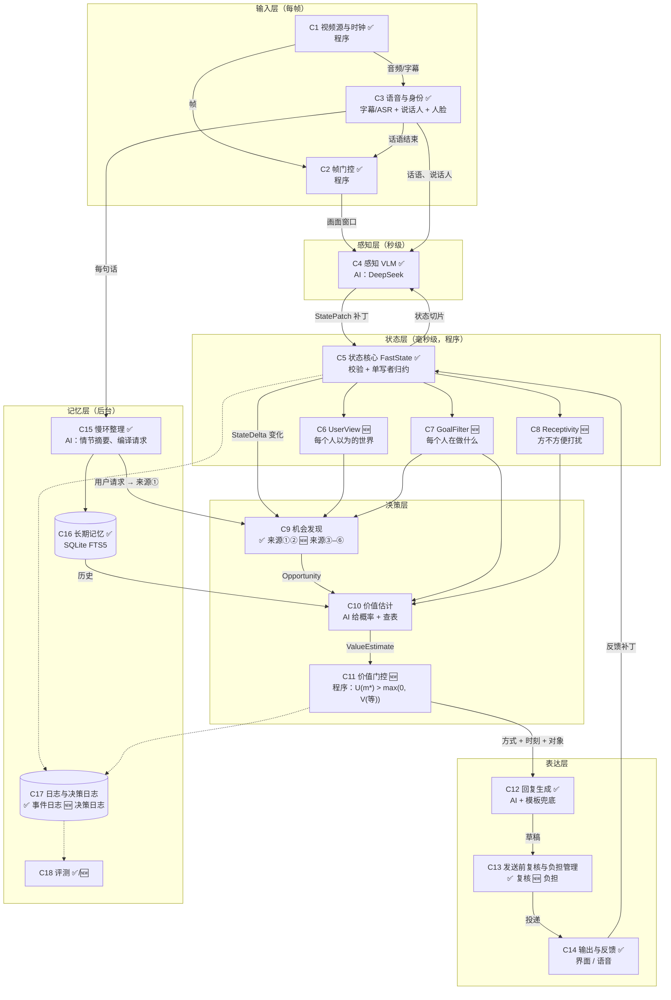

# Proactive 视频助理：主动性定义标准与系统框架

> 版本：2026-11-08
> 本文只讲两件事：
> - **第一部分：主动性的定义标准。** 什么算"主动"，什么时候该介入、怎么介入，怎么判断主动得好不好。
> - **第二部分：系统框架。** 整个系统分几层，每个组件做什么、输入输出是什么、是调用 AI 还是程序实现。
>
> 标记说明：✅ 已在 `D:\AScience\proactive-agent` 中实现；🆕 按本文定义需要新增或改造。
> 其他文档：`Proactive_Video_Agent_Technical_Design_V2.md` 是字段级详细设计；`reports/主动式AI助理介入决策形式化.md` 是文献调研全文。

---

## 0. 一页看懂

**系统是什么。** 一个看视频、听对话的家庭助理。它持续维护"家里现在是什么状态"。没人提问时，它自己判断要不要开口提醒或询问；有人提问或下指令时，它照常回答和执行。

**主动的定义。**

> **主动 = 没有人要求时，系统根据自己对状态的理解，判断"此刻以某种方式开口，比继续沉默更有价值"，从而发起的介入。**

**两套标准。**

| 标准 | 回答的问题 | 内容 |
|---|---|---|
| 定义标准 | 这次介入**算不算**主动？ | 四条全部满足：系统发起、依据状态、指向一个具体机会、经过权衡（第 2 章） |
| 价值标准 | 这次主动**值不值**？整个系统主动得**好不好**？ | 单次看开口价值 U，系统看主动增益 PG（第 3 章） |

**介入规则（一句话）。** 对每个机会，算出每种说法的价值，取最高的那个；只有它既大于 0、又大于"再等等"的价值时，才开口。

**系统骨架（六层）。**

```
输入层   视频帧 + 语音            → 挑出值得看的画面窗口
感知层   VLM 看画面               → 输出对状态的"修改建议"（补丁）
状态层   程序审核并写入状态        → 世界状态 + 每个人以为的状态 + 每个人在做什么 + 方不方便打扰
决策层   发现机会 → 估计价值 → 门控 → 决定：沉默 / 等 / 提示音 / 询问 / 提醒
表达层   生成话术 → 发送前复核 → 输出 → 收集用户反馈（反馈再写回状态）
记忆层   后台整理情节、编译用户请求、记日志、做评测（不阻塞上面五层）
```

---

# 第一部分　主动性定义标准

## 1. 定义

### 1.1 一句话定义

> **主动介入**：系统在未被要求时，基于自己对世界和人的理解，预判"此刻以某种方式开口（或行动）比继续沉默更有价值"，并据此发起的介入。

这句话里每个词都有约束作用：

| 关键词 | 约束 | 违反时的例子 |
|---|---|---|
| 未被要求 | 此刻没有人在向系统提问或下令 | 用户问"伞在哪"，系统回答。这是被动应答 |
| 基于理解 | 依据是系统维护的状态，而不是时钟或固定脚本 | 每天 8 点播报天气。这是定时任务 |
| 此刻 | 时机是判断出来的，不是条件一成立就说 | 一听到"可能下雨"就立刻提醒，哪怕人还要坐一小时 |
| 某种方式 | 方式也是判断出来的（提示音、询问、提醒……） | 不管什么情况都用同一句语音播报 |
| 比沉默更有价值 | 开口必须有理由，沉默也要有理由 | 条件成立就说，不考虑打扰和说错的代价 |

### 1.2 三种助理的区别

用同一个场景对比：Jack 说"今天可能下雨，别忘了带伞"，一小时后 Sophie 和 Lily 出门。

| 类型 | 谁决定要不要说 | 表现 | 局限 |
|---|---|---|---|
| 被动式 | 用户提问 | Sophie 问"伞在哪？"才回答 | 用户想不到问，就帮不上 |
| 规则触发式 | 工程师写好的条件 | "有人说过带伞 ∧ 有人在离开"成立就提醒 | 只认识写过的情况；标签一抖就漏；不会权衡 |
| 主动式 | 系统自己评估价值 | 判断出"她们马上出门、手里没伞、可能下雨、没人会提醒"，于是在出门前说 | 需要能算价值，并管住自己不乱说 |

### 1.3 为什么要分两套标准

"算不算主动"和"主动得好不好"是两回事：
- 一个系统可以完全符合主动的定义，但总是说错，那就是"主动地添乱"；
- 一个系统也可以从不出错，但只是因为从不开口，那等于没有主动性。

所以第 2 章先给出判定"是不是主动"的标准，第 3 章再给出衡量"值不值、好不好"的标准。

---

## 2. 定义标准：一次介入算不算"主动"

### 2.1 四条判定标准（必须同时满足）

| 编号 | 标准 | 检验方法 |
|---|---|---|
| ① | **发起方是系统**：此刻没有人向系统提问或下令 | 查对话记录：介入前没有面向系统的提问或指令 |
| ② | **依据是状态**：由系统对世界和人的状态理解引起 | 能列出引起它的状态条目，例如"Sophie.activity = moving_to_exit" |
| ③ | **指向一个机会**：说得清"对谁、什么问题、不管会怎样、最晚什么时候" | 机会表里有对应的 Opportunity 记录（见 2.2） |
| ④ | **经过权衡**：系统比较过"说 / 不说 / 等"，并给出理由 | 决策日志里有这次比较的数值和理由；沉默时同样有记录 |

用这四条检验几个例子：

| 例子 | ① | ② | ③ | ④ | 结论 |
|---|---|---|---|---|---|
| 用户问"伞在哪"，系统回答 | ✗ | — | — | — | 被动应答（L0），不算主动 |
| 每天 8 点播报天气 | ✓ | ✗ | ✗ | ✗ | 定时任务，不算主动 |
| "有人走向门口 ∧ 桌上有电脑"成立就提醒 | ✓ | ✓ | ✓ | ✗ | 规则触发；形式上是主动，但没有权衡，不合格 |
| 用户早上说"八点提醒我吃药"，系统在八点、看到他空闲时提醒 | ✓ | ✓ | ✓ | ✓ | 主动（L1：需求由用户定义，时机由系统判断） |
| Jack 收走了钥匙，Sophie 不知道；她准备出门时系统告诉她钥匙在哪 | ✓ | ✓ | ✓ | ✓ | 主动（L3：系统自己发现的需求） |

### 2.2 核心对象：机会（Opportunity）

**机会**是主动决策的基本单位。它描述的是：

> **某个人，在某件事上，可能会遇到某种不好的后果；系统有一定证据；如果要帮，最晚要在某个时刻之前帮。**

| 要素 | 含义 | 雨伞 | 钥匙被挪 | 燃气未关 |
|---|---|---|---|---|
| 对象 | 对谁说 | Sophie、Lily | Sophie | 家里任何人 |
| 问题 | 可能出什么事 | 出门没带伞会淋雨 | 出门找不到钥匙 | 锅烧干、火灾风险 |
| 证据 | 凭什么这么认为 | Jack 说要下雨；两人起身走向门口；手里没伞 | Sophie 看到钥匙在鞋柜；Jack 收进抽屉时 Sophie 不在场 | 灶台 = on；厨房 5 分钟无人 |
| 后果 | 不管会多糟 | 淋雨、折返 | 耽误 3–5 分钟 | 严重（安全） |
| 期限 | 最晚何时说 | 出门之前 | 她走到鞋柜前 | 越早越好 |

**机会只是候选，不等于要说。** 发现机会要尽量不漏，决定开口要尽量不错，两步分开做。

### 2.3 机会的六个来源

| 来源 | 一句话解释 | 例子 | 现状 |
|---|---|---|---|
| ① 用户请求 | 有人说过"提醒我……" | "别忘了带伞"；"八点提醒我吃药" | ✅ 语音编译成需求 |
| ② 风险模板 | 工程师预先登记的常见风险 | 忘带随身物品、电器没关 | ✅ 需求模板 |
| ③ 认知差 | 真实状态 ≠ 某人以为的状态 | 钥匙被别人挪了，主人不知道 | 🆕 优先做 |
| ④ 预期违背 | 和平时习惯或进行中的步骤不一样 | 平时出门关灯，今天没关 | 🆕 |
| ⑤ 目标推断 | 看出某人要做什么，进而想到他需要什么 | 穿外套、拿包 → 要出门 → 需要伞、钥匙、手机 | 🆕（现在只有瞬时标签"正在离开"） |
| ⑥ 风险预测 | 推演"没人管的话接下来会怎样" | 锅里的水快烧干；小孩靠近楼梯 | 🆕 |

现在的系统只有 ① 和 ②，所以只能算"规则触发 + 用户请求"。③–⑥ 才是"系统自己发现需求"。其中 ③ 最适合先做：状态库已经记录了每条信息是"看到的、听到的还是推断的"，再记下"谁在场看到了什么"，就能算出每个人以为的世界。

### 2.4 主动性等级

| 等级 | 名称 | 需求由谁定义 | 系统决定什么 | 例子 | 现状 |
|---|---|---|---|---|---|
| L0 | 被动应答 | 用户当场提问 | 怎么答 | "伞在哪？" | ✅ 保留（不算主动） |
| L1 | 时机主动 | 用户事先说过 | 什么时候说、怎么说 | "别忘了带伞" → 出门前提醒 | ✅ |
| L2 | 模板主动 | 工程师预先登记 | 要不要说、何时说、怎么说 | 忘带手机、电器没关 | ✅ |
| L3 | 开放主动 | 系统自己发现 | 全部（受授权和打扰预算约束） | 钥匙被挪；下雨了阳台还晾着衣服 | 🆕 目标 |

### 2.5 介入方式阶梯

从轻到重。越往下，越需要把握和授权。

| 级别 | 方式 | 例子 | 打扰程度 | 一般适用情况 |
|---|---|---|---|---|
| 0 | 沉默 / 只记录 | 写进记忆，不输出 | 无 | 价值不够 |
| 1 | 环境提示 | 提示音、指示灯、屏幕卡片 | 很低 | 有价值但把握不大，或对方正在说话 |
| — | 延后 | 等对方空下来再说 | 延后 | 不急，等一下损失不大 |
| 2 | 询问 | "包里带伞了吗？" | 中（需要回答） | 摄像头看不到关键事实，或需要确认授权 |
| 3 | 提醒 | "外面可能下雨，伞在门口柜子上" | 中 | 价值高、把握大 |
| 4 | 直接行动 | 通过智能家居关掉燃气 | 高（改变世界） | 已授权、风险可控、可撤销（远期） |

现在已实现的是 WAIT（等待 / 沉默）、ASK（询问）和 REMIND（提醒）。环境提示、延后和直接行动是 🆕。

### 2.6 授权边界

- **用户请求是独立的快速通道。** L0 提问直接回答，不经过价值门控。
- **"以后下雨都提醒我"会扩大授权；"别再提醒我这个"会提高这类提醒的代价。**
- **旁听到的话只算证据，不算授权。** Jack 对 Sophie 说"别忘了带伞"，不等于 Sophie 授权系统提醒她所有事。
- **直接行动必须有明确授权。** 没有授权时，最多只能提醒。

---

## 3. 价值标准：什么时候该介入，主动得好不好

### 3.1 决定开口价值的六个问题

每次考虑开口，系统要回答六个问题，每个问题对应一个量：

| 问题 | 符号 | 含义 | 雨伞（门口时刻） |
|---|---|---|---|
| 这事是真的吗？ | **p** | 机会成立的概率 | 会出门 × 没带伞 × 会下雨 ≈ 0.58 |
| 他自己会处理吗？ | **q** | 不提醒也会自己想起或被别人提醒的概率 | 很匆忙，0.15 |
| 不管会多糟？ | **L** | 机会成立且没人处理时的损失 | 淋雨折返，8 分 |
| 说了有用吗？ | **η** | 用某种方式说了以后，对方真会照做的概率 | 语音提醒 0.9；提示音 0.3 |
| 打扰要付出什么？ | **C** | 打扰代价 C_int，加上说错时的误报代价 C_FA | 提醒：打扰 1 分；说错再扣 1.5 分 |
| 还能等吗？ | **H** | 截止时刻马上就到的概率 | 几秒内就出门，0.85 |

**单位。** 统一用"分"：1 分 = 正常状态下被一句简短语音打扰一次的不便。

### 3.2 单次决策的计算规则

**用方式 m 开口的价值：**

$$
U(m) = \underbrace{p\,(1-q)\,\eta_m\,L}_{\text{预期避免的损失}} - \underbrace{(1-p)\,C_{FA}(m)}_{\text{说错的代价}} - \underbrace{C_{int}(m)}_{\text{打扰的代价}}
$$

纯文本写法：`U(m) = p×(1−q)×η×L − (1−p)×C_FA − C_int`

**再等等的价值：**
$$
V(\text{等}) = (1-H) \times \text{等一会儿之后最好的开口价值}
$$

**规则：**

> 选出价值最高的方式 m\*。只有当 **U(m\*) > max(0, V(等))** 时才开口；否则保持沉默，状态再变化时重新计算。

这一条规则同时回答了三个问题：
- **要不要介入**：U(m\*) > 0；
- **什么时候介入**：U(m\*) > V(等)，也就是"现在说"好过"再看看"；
- **怎么介入**：取 U 最大的方式 m\*。

### 3.3 算例

**雨伞（同一件事，三个时刻，三种决定）。** 参数：L = 8；提醒 η = 0.9、C_FA = 1.5、C_int = 1（对方说话时为 2）；询问 η = 0.85、C_FA = 1.0、C_int = 1.5（说话时 2.5）；提示音 η = 0.3、C_FA = 0.2、C_int = 0.1。

| 时刻 | 情境 | p | q | U(提醒) | U(询问) | U(提示音) | V(等) | 决定 |
|---|---|---|---|---|---|---|---|---|
| 13:58 | 坐着聊天，Jack 刚说可能下雨 | 0.13 | 0.3 | −2.7 | −2.8 | −0.06 | 高 | **沉默**，只记下"可能下雨、Jack 提醒过带伞" |
| 14:32 | 起身说"走吧"，还在说话 | 0.34 | 0.3 | −1.28 | −1.54 | +0.34 | ≈1.4 | **再等等**：再看几秒就知道她们拿没拿伞 |
| 14:40 | 匆忙走向门口，手里空着 | 0.58 | 0.15 | **+1.92** | +1.43 | +1.0 | ≈0.3 | **立刻语音提醒** |

14:40 的提醒逐项计算：0.58 × 0.85 × 0.9 × 8 ≈ 3.55（避免的损失）− 0.42 × 1.5 ≈ 0.63（说错的代价）− 1.0（打扰）= **1.92**。

**笔记本电脑（为什么沉默）。** "有人走向门口 ∧ 桌上有电脑"的模板成立，但 Jack 说过今天在家开会：p ≈ 0.025，q = 0.5，L = 5。U(提醒) ≈ −2.4，所以沉默。规则只能看到"条件成立"，价值计算能看到"这事不太可能，也没那么严重"。

**钥匙被挪（没有模板也能主动）。** 认知差生成器发现钥匙的真实位置（抽屉）和 Sophie 以为的位置（鞋柜）不一致，而她的目标"出门"需要钥匙。p ≈ 0.86，q = 0.3，L = 3。U(提醒) ≈ +0.42，U(提示音) ≈ +0.05（"滴"一声不能告诉她钥匙在哪）。所以她走到鞋柜前时说一句"钥匙在抽屉里"。如果她正在打电话，打扰代价升高，结论就变成"等她挂了再说"。

### 3.4 什么时候必须沉默（以及它们在公式里的位置）

| 情况 | 例子 | 在公式里的体现 |
|---|---|---|
| 对方已经知道 | 刚被别人提醒过，或亲眼看到了 | q 很高；认知差类机会根本不会生成 |
| 对方自己会处理 | 正走向伞架 | q 很高 |
| 没有实际损失 | 杯子换了个位置 | L ≈ 0 |
| 证据太弱 | 只看到一个模糊的影子 | p 很低 |
| 对方正忙、事情不急 | 在打电话、激烈交谈 | C_int 升高，V(等) 较高 → 延后 |
| 已经提醒过，或对方说过不需要 | 同一件事第三次 | 第二次 C_int × 2，第三次起禁止 |
| 不在授权范围 | 旁听到的隐私话题；未授权的"直接行动" | 硬规则，不进入计算 |

文献里最一致的结论是：**主动系统最常见的失败是话太多、说得太早，而不是漏说。** 所以"该沉默时沉默"和"该说时说"同样重要。

### 3.5 数字从哪里来

| 量 | 第一版 | 以后 |
|---|---|---|
| p | 状态库中相关信念的概率相乘；需要语义判断的部分（如"会不会下雨"）由 DeepSeek / Jev 给概率 | 用标注数据校准 |
| q | 按情境查表：匆忙 0.15、空闲 0.3、刚被人提醒过 0.4 | 从日志统计"没提醒也自己处理了"的比例 |
| L | 按类别查表 | 用户研究、偏好询问 |
| η | 按方式和机会类型查表 | 从"提醒后是否照做"中学习 |
| C_int、C_FA | 按方式和情境查表；短时间连续打扰会累积负担 | 从"不需要 / 关闭提醒"等反馈中学习 |
| H | 由目标进度估计：起身 → 走向门口 → 换鞋 → 开门 | 从数据学习 |

第一版损失表（初始假设，需要用数据校准）：

| 类别 | L | 例子 |
|---|---|---|
| 安全 | 100 | 燃气、门锁、小孩靠近危险处（另保留硬规则兜底） |
| 健康 / 财物 / 出门必需品 | 8–10 | 吃药、钥匙、钱包、雨伞 |
| 便利 | 3 | 东西被挪、找东西 |
| 信息 / 偏好 | 1 | "你喜欢的节目开始了" |

第一版方式表：

| 方式 | η（让人去做某事） | η（告知位置） | C_int（正常） | C_int（对方在说话 / 打电话） | C_FA |
|---|---|---|---|---|---|
| 提示音 / 灯 | 0.3 | 0.1 | 0.1 | 0.2 | 0.2 |
| 询问 | 0.85 | 0.85 | 1.5 | 2.5 | 1.0 |
| 提醒 | 0.9 | 0.9 | 1.0 | 2.0 | 1.5 |

### 3.6 系统级标准：整个系统主动得好不好

单次决策是事前估算。衡量系统要靠事后结算：在标注好的视频上运行系统，统计它实际创造的净价值。

**第一步：标注机会。** 每段视频由人标出所有机会，每个机会包括：对象、问题、有效窗口 [最早可说, 最晚应说]、损失 L，以及一个标签：
- **必须说**：不说就会有损失；
- **可说可不说**：例如对方很可能自己会处理；
- **不该说**：困难负例，例如已经拿了伞、刚被别人提醒过。

**第二步：给每次开口记分。**

| 情况 | 记分 |
|---|---|
| 在有效窗口内说中一个"必须说"的机会 | + L × 时效系数（窗口内为 1，超过截止后衰减到 0） |
| 每一次开口（不管对错） | − C_int |
| 说了但对不上任何机会，或说中"不该说" | 再 − C_FA |
| 同一机会重复提醒 | 再 − C_dup |
| 漏掉"必须说"，或在"可说可不说"上沉默 | 0 |

**第三步：算总分。**

- **净主动价值** NPV = 说中的收益 − 所有打扰 − 所有说错 − 所有重复
- **主动增益** PG = NPV（我们的系统）÷ NPV（完美助理）

"完美助理"指在每个"必须说"的机会上，都用最合适的方式准时说一次，从不说错。

| PG | 含义 |
|---|---|
| = 1 | 和完美助理一样 |
| = 0 | 和"从不说话"一样 |
| < 0 | 比不说话还糟：添的乱比帮的忙多 |

**第四步：配分项指标，用来定位问题。**

| 指标 | 定义 | 防止什么 |
|---|---|---|
| 及时命中率 | 窗口内说中的"必须说" ÷ 全部"必须说" | 什么都不说 |
| FAH（每小时误报） | 说错次数 ÷ 观测小时数 | 长时间运行让人烦 |
| 静默正确率 | "不该说"时确实没说的比例 | 该闭嘴时不闭嘴 |
| 提前量 | 开口时刻距最晚应说时刻的秒数 | 说得太晚 |
| 重复率 | 同一机会被提醒 ≥ 2 次的比例 | 唠叨 |
| 校准误差 ECE | 说"70% 把握"的事是否真有约 70% 成立 | 概率不可信，规则就失效 |

只看命中率，系统会学会什么都说；只看误报，系统会学会什么都不说。**PG + FAH + 提前量三者一起看**，才能回答"它的主动到底有没有用"。

---

# 第二部分　系统框架

## 4. 总体设计

### 4.1 设计原则

| 原则 | 含义 | 为什么 |
|---|---|---|
| AI 提议，程序裁决 | VLM 只能提出"状态修改建议"，只有一个确定性程序能真正修改状态 | 模型会出错、会重复、会自相矛盾；程序可以校验、可审计、可重放 |
| 状态是唯一事实来源 | 所有判断都基于状态库，不直接基于原始画面 | 决策可解释：每次开口都能指向具体状态条目 |
| 发现与决定分开 | 机会生成器宁可多报；价值门控负责少说、说准 | 两个目标相反，混在一起两头都做不好 |
| 模型估计，规则选择 | 模型回答概率问题（p、q……），公式和规则决定说不说 | 估计可以单独校准；决定可以解释、可以复现 |
| 慢环不阻塞热路径 | 情节整理、长期记忆在后台跑，失败不影响实时提醒 | 实时性优先 |
| 因果性 | 任何决策只能用"决策时刻之前已经可用"的信息 | 评测时防止偷看未来 |

### 4.2 总体架构图



如果阅读器不显示 Mermaid，可以看这个文本版：

```
输入层   C1 视频源/时钟 ──帧──► C2 帧门控 ──3 帧窗口──┐      C3 语音与身份（话语、说话人、人脸）
                                                     ▼            │
感知层   C4 感知 VLM（看 3 帧 + 当前状态切片 + 最近话语）──► StatePatch
                                                     ▼
状态层   C5 校验 → 单写者归约 → FastState（实体 + 信念）──► StateDelta
         🆕 C6 UserView      🆕 C7 GoalFilter      🆕 C8 Receptivity
                                                     ▼
决策层   C9 机会发现（6 个来源）──► C10 价值估计（p q L η C H）──► C11 价值门控
                                                     ▼
表达层   C12 回复生成 ──► C13 发送前复核 / 负担管理 ──► C14 输出 ──反馈──► 回到 C5
记忆层   C15 慢环整理   C16 长期记忆   C17 日志   C18 评测          （后台，不阻塞）
```

### 4.3 三个时间尺度

| 层级 | 节奏 | 包含组件 | 调用 AI 的情况 |
|---|---|---|---|
| L0 前端 | 每帧（抽样 5 FPS） | C1、C2、C3 | C3 可选本地小模型（ASR、人脸）；其余为纯程序 |
| L1 热路径 | 秒级 | C4–C14 | 每个画面窗口 1 次 VLM；机会需要语义概率时 1 次决策模型；要开口时 1 次回复生成（可提前预生成） |
| L2 慢环 | 每句话 / 每 30 秒 | C15–C18 | 每句话 1 次请求编译；每 30 秒 1 次情节摘要 |

### 4.4 组件总表

| 编号 | 组件 | 一句话职责 | 实现方式 | 代码位置 | 状态 |
|---|---|---|---|---|---|
| C1 | 视频源与时钟 | 解码视频、给每帧打时间戳；支持离线、按 1× 回放、实时流三种模式 | 程序（PyAV） | `pa/source/` | ✅ |
| C2 | 帧门控 | 决定什么时候把哪几帧送去看 | 程序（帧差） | `pa/gate/gate.py` | ✅ |
| C3 | 语音与身份 | 提供话语、说话人和人脸锚点 | 程序 + 可选本地模型 | `pa/speech/` | ✅ |
| C4 | 感知 VLM | 看画面，对照当前状态，输出修改建议 | **AI**（DeepSeek） | `pa/perception/` | ✅ |
| C5 | 状态核心 | 校验补丁、按规则写入状态、产生变化记录 | 程序（单写者） | `pa/state/` | ✅ |
| C6 | UserView | 推算每个人以为的世界 | 程序 | `pa/state/userview.py` | 🆕 |
| C7 | GoalFilter | 估计每个人当前目标及进度 | 程序（贝叶斯滤波） | `pa/state/goals.py` | 🆕 |
| C8 | Receptivity | 判断此刻方不方便打扰 | 程序 | `pa/state/receptivity.py` | 🆕 |
| C9 | 机会发现 | 把值得注意的情况变成机会 | 程序 + 受约束的 AI | `pa/agenda/` ✅、`pa/opportunity/` 🆕 | 部分 |
| C10 | 价值估计 | 算出 p、q、L、η、C、H | **AI** 给概率 + 查表 | `pa/decision/` ✅ → `pa/value/estimator.py` 🆕 | 改造 |
| C11 | 价值门控 | 决定沉默、等待还是用某种方式开口 | 程序 | `pa/value/gate.py` | 🆕 |
| C12 | 回复生成 | 把决定写成一句话，并标明每个说法的把握 | **AI** + 模板兜底 | `pa/response/drafter.py` | ✅ |
| C13 | 发送前复核与负担管理 | 发出前再核对一次；控制打扰频率 | 程序 | `pa/policy/gate.py` ✅、`pa/policy/burden.py` 🆕 | 部分 |
| C14 | 输出与反馈 | 展示和播放；收集"已拿到 / 不需要 / 不是我的" | 程序 + 网页 | `pa/ui/` | ✅ |
| C15 | 慢环整理 | 情节摘要；把话语里的请求编译成需求 | **AI**（后台） | `pa/slow/consolidator.py` | ✅ |
| C16 | 长期记忆 | 存储情节，支持检索 | 程序（SQLite FTS5） | `pa/memory/episodes.py` | ✅ |
| C17 | 日志与决策日志 | 记录所有补丁、变化、决策、投递 | 程序（SQLite） | `pa/storage/log.py` ✅、`decision_log.py` 🆕 | 部分 |
| C18 | 评测 | 在数据集上跑系统并计算指标 | 脚本 | `pa/bench/` ✅、`pa/eval/opportunities.py` 🆕 | 部分 |

所有组件由 `pa/runtime/engine.py` 串起来，命令行入口是 `pa`（`pa run`、`pa ui`、`pa bench`）。

---

## 5. 各组件说明

每个组件按同一格式说明：**做什么 → 输入 / 输出 → 怎么实现 → 关键规则**。

### 5.1 输入层

#### C1 视频源与时钟 ✅

- **做什么**：把视频变成带时间戳的帧流。
- **输入 / 输出**：视频文件或实时流 → 帧（`frame_id`、时间戳、图像）。
- **怎么实现**：PyAV 解码，按 5 FPS 抽样、缩放。三种运行模式：
  - **sim**：虚拟时钟，把实测的模型时延加进去，最快地离线跑完；
  - **realtime**：按 1× 速度回放文件，模拟真实时间；
  - **live**：接实时流，用墙钟时间戳，后台线程读帧。
- **关键规则**：每个信息都带"什么时候可用"的时间戳 `t_avail`，保证决策不使用未来信息。

#### C2 帧门控 ✅

- **做什么**：决定什么时候、把哪几帧送给 VLM。不能每帧都看（太贵太慢），也不能漏掉重要变化。
- **输入 / 输出**：帧流 + 话语结束信号 + 关注对象 → 画面窗口（默认 3 帧）。
- **怎么实现**：纯程序，计算灰度帧差。
- **关键规则**，以下任一情况发出窗口：
  - **画面变化**：和上一窗口末帧的差异超过阈值（0.08），等画面稳定后发出；
  - **话语结束**：有人说完一句话，立即看一眼当时的画面；
  - **心跳**：4 秒没发过窗口就发一次；
  - **重点关注**：有活跃的需求或机会时，相关对象的心跳缩短到 1.5 秒；
  - 两个窗口之间至少间隔 0.8 秒。

#### C3 语音与身份 ✅

- **做什么**：提供"谁在什么时候说了什么"，以及人脸、声音等身份锚点，帮系统把画面里的人对上号。
- **输入 / 输出**：音频或字幕 → 话语（`utt_id`、说话人、文本、起止时间）、人脸框。
- **怎么实现**：
  - 目前用 M3-Bench 自带的字幕（含说话人姓名），并按设定时延模拟实时到达；
  - ASR 为可选接入；
  - 人脸检测复用 M3-Agent 的 `face_extraction`（`pa/third_party/m3agent/`）。
- **关键规则**：话语结束会触发 C2 看一眼画面，同时送 C15 做请求编译。

### 5.2 感知层

#### C4 感知 VLM ✅

- **做什么**：看画面，对照当前状态，**只输出需要修改的地方**（补丁），不写长篇描述。
- **输入 / 输出**：
  - 输入：3 帧画面 + 状态切片（当前相关实体、它们的信念，以及要求模型核对的 CHECK 清单）+ 最近话语；
  - 输出：StatePatch。
- **怎么实现**：
  - DeepSeek `deepseek-flash`，关闭思考模式，JSON 输出，单次约 1.5 秒（P50）；
  - 最多 4 个请求并行，由排序器按窗口顺序提交，避免乱序；
  - 提示词版本 p-2.3，见 `pa/perception/prompt.py`。
- **补丁里允许的操作**：

| 操作 | 含义 | 例子 |
|---|---|---|
| `new` | 发现新实体 | 新出现一把伞 |
| `set` | 设置属性，并标注来源（看到 / 听到 / 推断） | `umbrella_1.location = ON shelf_1` |
| `act` | 观察到动作 | Sophie `PICK_UP` bag_1 |
| `still` | 确认某条信念仍然成立 | 伞还在架子上 |
| `gone` | 区域清楚可见，但东西不在了 | 架子上的伞没了 |
| `unsure` | 看不清，不下结论 | 被遮挡 |
| `said` | 把一句话和相关实体关联，标注意图 | Jack 说"别忘了带伞"，意图为 request |
| `link` | 把人和人脸 / 声音锚点绑定 | person_2 ↔ 说话人 Sophie |

- **关键规则**：模型必须对 CHECK 清单里的每一项给出 `still`、`gone`、`set` 或 `unsure` 之一，这样"没看到"和"看到它不在"就能区分开。

### 5.3 状态层（系统的"世界模型"）

#### C5 状态核心 FastState ✅

- **做什么**：维护"家里现在是什么样"。它是唯一能修改状态的组件。
- **输入 / 输出**：
  - 输入：来自 VLM、用户反馈、慢环的补丁；
  - 输出：新的状态版本 + StateDelta（这次改了哪些信念、从什么变成什么、为什么）。
- **怎么实现**：纯 Python，常驻内存，每个补丁处理不到 10 毫秒，分四步：

```
补丁 ──► 排序器（按窗口顺序放行）──► 校验器（逐条检查，不合法的单条丢弃）──► 归约器（按规则写入）──► StateDelta
```

- **数据结构**：
  - **实体**：人、物品、地点、设备，每个有 ID、类别、描述、身份锚点、最近一次拿过它的人（`last_holder`）；
  - **信念**：每个"实体.属性"一条，记录当前值、来源、状态和证据：

```
信念 phone_1.location
  值：    ON desk_1
  来源：  seen（看到） / heard（听到） / inferred（推断） / user_confirmed（用户确认） / consolidator（慢环）
  状态：  holds（成立） / stale（过时） / unknown（未知） / conflicted（冲突）
  历史：  last_seen（最后一次亲眼看到的值和时间，永不清除）
```

- **属性注册表**：哪些属性可以写、取值范围、多久过时：

| 属性 | 适用于 | 动态类别 | 过时方式 |
|---|---|---|---|
| location（位置） | 物品、设备 | 惯性 | 不随时间过时，只因事件过时（见下） |
| state（开 / 关） | 设备、地点 | 惯性 | 同上 |
| room（所在房间） | 人、物品、设备 | 惯性 | 同上 |
| activity（在做什么） | 人 | 瞬时 | 8 秒没被再次支持就过时 |
| presence（在不在画面） | 人 | 瞬时 | 6 秒后变为"不在画面" |
| near（靠近什么） | 人 | 瞬时 | 5 秒过时 |
| owner（归属） | 物品、设备 | 静态 | 只能由"听到"或"用户确认"写入 |

- **关键规则**：
  1. **惯性属性只因事件过时。** 物品不会自己移动，所以"一段时间没看到"不代表位置失效。只有两种情况会让它失效：有人在看不见的时候接触过它所在的区域；或者区域清楚可见但东西不在（`gone`）。第一人称视角下镜头经常转开，这条规则很关键。
  2. **冲突按来源优先级裁决**：用户确认 > 看到 > 听到 > 推断 / 慢环。
  3. **过期判断以感知进度为准。** 只有当晚于这条信念的画面已经被处理过、却没有再次支持它时，才判它过期，避免因为模型还在处理中而误判。
  4. **并发创建去重。** 多个窗口并行时，同一个新物品可能被创建两次，归约器会合并。
  5. **可重放。** 所有补丁写入日志，任何时刻的状态都能按日志重放得到。

#### C6 UserView：每个人以为的世界 🆕

- **做什么**：记录每个人对每件事看到过、听到过、被告知过什么，推出他"以为"的值。它是认知差机会（来源 ③）的基础。
- **输入 / 输出**：StateDelta + 谁当时在场（presence、room）+ 话语 → 每人一份"信念视图"。
- **怎么实现**：程序规则：
  - 某人在场且画面清楚时发生的变化，算"他看到了"；
  - 有人对他说起，算"他听到了"；
  - 否则他的认知停留在最后一次看到或听到时。
- **例子**：钥匙从鞋柜被移到抽屉时 Sophie 不在场，所以 `Sophie 以为 keys_1.location = ON shoe_cabinet`，而真实值是 `INSIDE drawer_1`。两者不一致，就是一个认知差。

#### C7 GoalFilter：每个人在做什么 🆕

- **做什么**：估计每个人当前目标（出门、做饭、休息……）的概率和进度，给出截止风险 H。它取代现在不稳定的瞬时标签"正在离开"。
- **输入 / 输出**：动作、位置、activity、话语 → `{目标: 概率, 进度阶段}`，例如 `{leave_home: 0.97, 阶段: 走向门口}`。
- **怎么实现**：小型隐马尔可夫模型或贝叶斯滤波，融合多条证据（起身、拿包、说"走吧"、走向门口）。单帧标签抖动只会让概率小幅波动，不会让判断翻转。

#### C8 Receptivity：方不方便打扰 🆕

- **做什么**：判断此刻打扰的代价高不高。
- **输入 / 输出**：语音活动（是否正在说话）+ activity → 情境标签（空闲 / 匆忙 / 正在说话 / 正在打电话），用来查 C_int 和 q。
- **怎么实现**：程序规则。

### 5.4 决策层

#### C9 机会发现

- **做什么**：把"值得注意的情况"变成机会，放进机会表。宁可多报，因为是否开口由后面决定。
- **输入 / 输出**：StateDelta、UserView、GoalFilter、用户请求 → Opportunity（持续活跃，直到解决、过期或被抑制）。
- **现在已有的两个来源 ✅**（代码中叫"需求 Need"）：
  - **来源 ① 用户请求**：C15 把每句话送给 LLM 判断是否包含请求，例如"别忘了带伞"会被编译成一个需求，附带触发和解决条件；
  - **来源 ② 风险模板**：`pa/agenda/templates.yaml` 里登记了"可能忘带物品"和"电器没关"两类模板。

  每个需求用 JSON 条件描述三个时刻：
  - **arm**：进入关注；
  - **fire**：应该决定了；
  - **resolve**：已经解决。

  状态变化时，触发引擎只重算受影响的需求（依赖索引），产生 `armed`、`fired`、`resolved` 等事件。进入 `armed` 时预先生成回复草稿，到 `fired` 时调用决策模型。
- **要新增的四个来源 🆕**：
  - **③ 认知差**：比较 UserView 和真实状态，差异与此人当前目标相关时生成机会；
  - **④ 预期违背**：和习惯或流程的下一步比较；
  - **⑤ 目标推断**：由 GoalFilter 的目标推出需要的物品和步骤；
  - **⑥ 风险预测**：受约束的 LLM 只向前推演 1–2 步。
- **改造点**：需求从"fire 上升沿才决策"改为"机会活跃期间，相关状态一变就重新估值"；模板从"唯一入口"降级为来源之一。

#### C10 价值估计

- **做什么**：为每个活跃机会算出 p、q、L、η、C、H，再按第 3.2 节的公式算出各方式的 U(m) 和 V(等)。
- **输入 / 输出**：Opportunity + 状态快照 + 情境 + 历史 → ValueEstimate。
- **现在 ✅**：
  - 决策模型（DeepSeek，Jev 位置已预留）读取决策上下文，直接给出"值不值得说"的概率和 WAIT / ASK / REMIND 的选择；
  - 再由规则做后处理：概率低于 0.7 就等待；方式不能超过上限；必须有权限。
- **改造后 🆕**：
  - 模型不再直接做决定，只回答类型化的概率问题，例如"她们 1 分钟内出门的概率""包里有伞的概率"；
  - L、η、C 查表（`pa/value/costs.yaml`）；q 由 Receptivity 和 UserView 给出；H 由 GoalFilter 给出。
- **为什么这样分工**：模型直接给出"提醒或等待"时，估计误差和偏好混在一起，没法校准，也没法解释沉默。拆开以后，概率可以单独校准，决定可以复现。

#### C11 价值门控 🆕

- **做什么**：执行唯一的决策规则 U(m\*) > max(0, V(等))，决定沉默、等待还是用 m\* 开口，以及对谁说。
- **输入 / 输出**：ValueEstimate → 决定（SILENT / AMBIENT / ASK / REMIND / ACT）+ 人能读懂的理由，例如"p=0.58，匆忙，3 秒内出门"。
- **怎么实现**：纯程序，确定性。每次结果，包括沉默，都写入决策日志。

### 5.5 表达层

#### C12 回复生成 ✅

- **做什么**：把决定写成一句简短的话，并标明每个说法的把握程度。
- **输入 / 输出**：机会 + 方式 + 状态快照 → 草稿（文本 + claims + 证据）。claims 的每一条标为 certain（确定）、probable（可能）或 question（询问）。
- **怎么实现**：
  - DeepSeek 生成；机会进入关注时提前生成草稿，真要说时直接用；
  - 600 毫秒内拿不到草稿就用模板兜底。
- **关键规则**：只有亲眼看到或用户确认、且足够新的信念，才能写成"确定"的语气。

#### C13 发送前复核与负担管理

- **做什么**：在真正发出前最后核对一次，并控制打扰总量。
- **怎么实现**：纯程序，不调模型。
- **现在已有的检查 ✅**：

| 检查 | 不通过时 |
|---|---|
| 问题是否已经解决 | 拦截 |
| 触发条件是否仍然成立（10 秒宽限，适应"走向门口"这类瞬时信号） | 拦截 |
| 方式是否超过当前允许的上限 | 降级为询问 |
| 写成"确定"的说法是否真的有新鲜的亲眼证据 | 降级为询问 |
| 是否有权限 | 拦截 |
| 距离上一次投递是否不到 30 秒 | 拦截，稍后重试 |
| 同一需求是否已达到提醒次数上限（默认 2 次） | 拦截 |

- **要新增的负担管理 🆕**：
  - 每次投递后累积打扰负担（X ← 0.95·X + 1），计入后续的 C_int；
  - 按人去重；
  - 第二次提醒 C_int × 2，第三次起禁止；
  - 建立授权账本，记录谁授权了什么。

#### C14 输出与反馈 ✅

- **做什么**：把消息展示或播放出来，收集用户反馈，并把反馈写回状态。
- **怎么实现**：
  - FastAPI + SSE 网页界面（`pa ui`，地址 http://127.0.0.1:8765），可实时运行，也可回放历史运行；
  - 反馈按钮"已拿到 / 不需要 / 不是我的"分别对应 done / not_needed / wrong，作为用户补丁送回 C5。
- **关键规则**："提醒已发出"不等于"问题已解决"。只有状态显示已解决（例如看到她拿起了伞）或用户确认，才算解决。

### 5.6 记忆与学习层（后台）

#### C15 慢环整理 ✅

- **做什么**，分两件事：
  1. **逐句扫描**：每句话都判断是否包含请求或承诺；如果有，就编译成需求（机会来源 ①），附带主题、摘要和条件；
  2. **定期摘要**：每 30 秒把这段时间的状态变化和对话整理成一个情节（episode）。
- **怎么实现**：DeepSeek，后台运行，失败只会丢失摘要和请求编译，实时链路照常工作。

#### C16 长期记忆 ✅

- **做什么**：存储情节，供决策时检索"之前发生过什么"。
- **怎么实现**：SQLite FTS5 全文检索；每个情节带 `t_avail`，检索时只返回决策时刻之前已经可用的情节。

#### C17 日志与决策日志

- **现在 ✅**：`log.sqlite` 追加记录所有补丁、状态变化、需求事件、决策、草稿和投递；`ui_events.jsonl` 供界面回放。
- **要新增 🆕**：决策日志记录每次价值评估的全部中间量（p、q、L、η、C、H、U、V(等)），以及各方式被选中的概率和事后结果（是否照做、是否自行解决）。这是以后校准、个性化和离线评估的前提。

#### C18 评测

- **现在 ✅**：`pa bench` 可以下载 M3-Bench 视频与标注，并在指定时刻用状态回答问题（状态探针）。
- **要新增 🆕**：`pa/eval/opportunities.py` 读取人工标注的机会和运行事件，计算 PG、NPV、FAH、及时命中率、提前量、静默正确率等（第 3.6 节）。

---

## 6. 数据流：一次完整的主动介入

以 living_room_06 的雨伞片段为例（视频 13:30 起），按时间顺序看数据怎样从画面流到一句提醒。时间为视频时刻；带 🆕 的步骤是改造后的流程。

> 下表是**示意**：窗口编号、补丁内容和数值是为说明数据流动而构造的，不是某次运行的真实日志。真实视频里两人确实忘了伞（82 秒时 Jack 才发现），14:45 那一行假设的是"提醒生效"的情况。

| 时刻 | 组件 | 发生了什么 | 产生的数据 |
|---|---|---|---|
| 13:58 | C3 → C15 | Jack 说"今天可能下雨，别忘了带伞" | 话语 `utt_12`（说话人 Jack） |
| 13:59 | C15 → C9 | 逐句扫描判断这句话包含请求，编译成需求 | 机会 ①：`forget:umbrella`，对象 = 将要出门的人 |
| 13:59 | C10 → C11 🆕 | 估值：p ≈ 0.13，U(提醒) = −2.7，V(等) 高 | 决定：**沉默**（写入决策日志） |
| 14:32 | C2 → C4 | 两人起身，画面变化触发窗口 | 画面窗口 `w_215`（3 帧） |
| 14:32 | C4 → C5 | VLM 输出补丁 | `set Sophie.activity = standing`；`said "走吧准备一下"` |
| 14:32 | C5 → C7 🆕 | 状态更新后，目标滤波更新 | `Sophie: leave_home 0.8，阶段 = 准备` |
| 14:32 | C10 → C11 🆕 | p ≈ 0.34，U(提示音) = +0.34，V(等) ≈ 1.4 | 决定：**再等等** |
| 14:40 | C2 → C4 | 走向门口，画面变化触发窗口 | 画面窗口 `w_231` |
| 14:40 | C4 → C5 | VLM 输出补丁 | `set Sophie.activity = moving_to_exit`；`still umbrella_1.location = ON shelf_1` |
| 14:40 | C7、C8 🆕 | 目标与情境更新 | `leave_home 0.97，阶段 = 走向门口`；情境 = 匆忙、没在说话 |
| 14:40 | C10 → C11 🆕 | p ≈ 0.58，q = 0.15，U(提醒) = +1.92 > V(等) ≈ 0.3 | 决定：**REMIND**，对象 Sophie、Lily |
| 14:41 | C12 | 使用预生成的草稿 | "外面可能下雨，伞还在架子上，记得带上。"（伞的位置为 certain，下雨为 probable） |
| 14:41 | C13 | 复核：未解决、条件仍成立、伞的位置有新鲜的亲眼证据、频率未超限 | 通过 → 投递 |
| 14:41 | C14 | 界面显示并播放 | Delivery 记录 |
| 14:45 | C4 → C5 → C9 | 看到 Sophie 拿起伞 | `act Sophie PICK_UP umbrella_1` → 机会 resolved |
| 事后 | C17 → C18 | 对照标注，命中"必须说"且在窗口内 | 记 +8 − 1 = +7 分 |

**现在系统实际走的路径 ✅**：13:59 编译出需求，14:35 左右（实测 65–67 秒）`moving_to_exit` 让需求的 fire 条件成立，然后决策模型给出 REMIND，经复核后投递。区别在于中间没有显式的 p、q、V(等) 计算，所以它只能在条件成立时决定，不能解释"为什么之前没说"，也看不到模板以外的情况。

**用户主动提问的路径（被动通道）**：Sophie 问"伞在哪？" → C3 话语 → 直接查询 C5 状态和 C16 记忆 → C12 生成回答 → C14 输出。这条通道不经过价值门控。

---

## 7. 关键数据结构速查

```python
# ---------- 状态层（✅ pa/schemas/state.py） ----------
Entity:      id, type(PERSON/OBJECT/PLACE/DEVICE), cls, desc, anchors{face,voice},
             room, last_visible_ms, last_holder, created_version
Belief:      key("phone_1.location"), value, source(seen/heard/inferred/user_confirmed/consolidator),
             status(holds/stale/unknown/conflicted), dynamics(static/inertial/transient),
             since_ms, last_support_ms, last_seen, evidence, support_version
StateDelta:  version_from → version_to, t_event_ms, t_avail_ms, caused_by,
             changes[ key, old → new, old_status → new_status, source, reason ]

# ---------- 感知补丁（✅ pa/schemas/patch.py） ----------
StatePatch:  patch_id, source(vlm/user/consolidator), window_id, seq, slice_version, t_event_ms,
             view{room, visible_places, persons_visible, quality},
             ops[ new | set | act | still | gone | unsure | said | link            # VLM 可用
                | confirm | need_feedback                                       # 用户可用
                | need_upsert | merge ]                                          # 慢环可用

# ---------- 决策层：现在（✅ pa/schemas/agenda.py, decision.py） ----------
Need:        need_id, kind, origin(template/speech), bindings, arm/fire/resolve(JSON 条件),
             phase(idle/armed/fired/deciding/resolved/...), reminders_sent, meta{topic, summary}
Decision:    warranted(值得说的概率), mode_probs{WAIT,ASK,REMIND}, applied_mode, rule_notes, reason

# ---------- 决策层：改造后（🆕） ----------
Opportunity:   key("forget:umbrella:person_2"), source(request/template/belief_gap/expectation/goal/forecast),
               addressee[], problem, category(safety/essential/convenience/info), evidence[],
               deadline_hint("goal:leave_home"), status(active/resolved/expired/suppressed)
ValueEstimate: p, q, L, eta{mode}, c_int{mode}, c_fa{mode}, hazard(H),
               utility{mode: U}, v_wait, decision(SILENT/AMBIENT/ASK/REMIND/ACT), reason
DecisionRecord: t, opportunity_key, estimate, propensity{mode}, delivered, text,
               feedback(done/not_needed/wrong/ignored), outcome{是否照做, 是否自行解决}

# ---------- 表达层（✅ pa/schemas/decision.py） ----------
ResponseDraft: mode(ASK/REMIND), text, claims[ key, value, stated_as(certain/probable/question) ],
               evidence, origin(prefetch/on_demand/template_fallback)
Delivery:      delivery_id, need_id, mode, decision_id, draft_id, text, t
```

---

## 8. 现状与差距

| 方面 | 现在 | 目标 |
|---|---|---|
| 主动等级 | L1（用户请求）+ L2（模板） | L3：六个来源的开放主动 |
| 决策单位 | Need，fire 上升沿时才决策 | Opportunity，活跃期间持续估值 |
| 决策方式 | 模型直接给 WAIT / ASK / REMIND，再加规则后处理 | 模型给概率，公式和规则决定 |
| 人的状态 | 瞬时标签（activity、presence），容易抖动 | 加上目标概率与进度（GoalFilter）、每个人以为的世界（UserView）、可打扰度（Receptivity） |
| 介入方式 | 等待、询问、提醒 | 增加环境提示、延后，以及远期的直接行动 |
| 打扰控制 | 30 秒全局间隔 + 每个需求最多提醒 2 次 | 累积负担、按人去重、授权账本 |
| 评测 | 单片段命中、状态探针 | 机会标注 + PG / FAH / 提前量 |

**已有实测（样本很小，只能作参考）**：
- 片段：living_room_06 雨伞片段，全 DeepSeek 实时运行 3 次；
- 结果：2 次及时提醒（65.1 秒、67.2 秒，比 82 秒的截止早 15–17 秒），0 误报；
- 失败原因："正在离开"这个瞬时标签不稳定，正是 GoalFilter 要解决的问题。

---

## 9. 术语表

| 术语 | 含义 |
|---|---|
| 主动介入 | 没人要求时，系统判断"开口比沉默更有价值"而发起的介入 |
| 机会 Opportunity | 某人在某事上可能遇到不好的后果、需要在期限前帮忙的候选情况 |
| 开口价值 U(m) | 用方式 m 开口的预期净收益：避免的损失 − 说错的代价 − 打扰的代价 |
| 等待价值 V(等) | 先不说、等一会儿再决定的预期价值 |
| p / q / L / η / C / H | 成立概率 / 自行处理概率 / 损失 / 有效率 / 代价 / 截止风险 |
| NPV | 净主动价值：评测中实际创造的总收益减去总代价 |
| PG 主动增益 | NPV ÷ 完美助理的 NPV；0 = 从不说话，1 = 完美，< 0 = 添乱 |
| FAH | 每小时误报次数 |
| FastState | 常驻内存的世界状态：实体 + 信念 |
| 信念 Belief | 一条"实体.属性"的当前判断，带来源、状态和证据 |
| StatePatch | VLM、用户或慢环对状态提出的修改建议 |
| StateDelta | 状态核心写入后产生的变化记录 |
| 惯性 / 瞬时 / 静态属性 | 不随时间过时（如位置）/ 几秒不支持就过时（如动作）/ 基本不变（如归属） |
| UserView | 每个人以为的世界 |
| 认知差 | 真实状态与某人以为的状态不一致 |
| GoalFilter | 估计每个人当前目标与进度的组件 |
| Receptivity | 此刻方不方便被打扰 |
| 价值门控 | 执行 U(m\*) > max(0, V(等)) 的确定性规则 |
| 单写者 | 只有状态核心能修改状态，其他组件只能提补丁 |
| t_avail | 一条信息在什么时刻开始可用，用于保证因果性 |
